# Face Liveness & Presentation Attack Detection — Production Architecture Proposal

**Scope:** MOSIP Registration Client (Desktop + Android) — resident face capture, operator authentication, supervisor authentication.
> Some evidence documents referenced below are internal and are not part of this public repository.

**Status:** Architecture proposal **v0.2**, with the v0.3 session-security implementation notes (2026-10-24, local only) — Phase 0 (device frames, capture binding, latency) completed against a mock SBI device; see `docs/phase0/PHASE0_REPORT.md`. Architecture B remains the leading hypothesis, not a proven winner. Production implementation has not started.
**Authoritative requirements source:** `04_Face_Liveness_Detection_and_Presentation.pdf` (MOSIP Decode PS #04), referred to below as **PS**.
**Date:** 2026-10-23

**Evidence labels used throughout**

| Label | Meaning |
|---|---|
| **[STD]** | Published standard or official specification |
| **[DOC]** | Official vendor/project documentation |
| **[CODE]** | Verified by reading the MOSIP source code (commit noted) |
| **[RES]** | Peer-reviewed or preprint research evidence |
| **[ENG]** | Established engineering practice |
| **[PROP]** | Our own proposed design — a hypothesis until validated |
| **[UNVERIFIED]** | Claim we could not verify during this research pass |

No figure in this document is a measured result unless it is explicitly labelled as one. Every latency, accuracy or resource number is a **target** or **budget** to be validated.

---

## Table of contents

1. Executive summary
2. Requirements traceability matrix
3. Research review
4. Architecture alternatives and weighted comparison
5. Recommended target architecture
6. System and component diagrams
7. Critical-path latency analysis
8. Model-selection strategy
9. Security threat model
10. Decision state machine and security invariants
11. Desktop and Android integration strategy
12. Offline deployment design
13. Performance benchmark plan
14. PAD accuracy and generalization evaluation plan
15. Testing strategy
16. Operational lifecycle
17. Technology choices and rejected alternatives
18. Implementation phases and dependencies
19. Major risks and mitigations
20. Acceptance criteria for production readiness
21. Final design review (answers to the ten review questions)
22. References

---

## v0.2 — Changes from Phase 0

Evidence for each item is in `docs/phase0/PHASE0_REPORT.md` and `docs/phase0/REVIEW_LOG.md`. Where a later section says otherwise, this list wins.

| # | Change | Why (Phase-0 evidence) | Sections affected |
|---|---|---|---|
| C1 | **Capture binding is a defined protocol** (10 ordered checks, §3.2 of the report). The device **must echo the RCAPTURE `transactionId` nonce** and sign a timestamp; devices that do not cannot be approved. New invariant I13 | 11 attack/fault scenarios rejected and the genuine capture bound, end to end; the existing MOSIP SBI 1.0 path sends no nonce (its request DTO drops it) and checks neither nonce nor timestamp (R7); fixing that is a prerequisite for desktop binding | 9 (T7/T8), 10.2, 11.3 |
| C2 | **Capture-PAD rule (unresolved).** Proposed on 2026-10-23: capture PAD as veto-only. **Revised on 2026-10-24: not recommended**; the default is the conservative accept gate (capture P(real) ≥ 0.80 to bind, < 0.20 = ATTACK, UNCERTAIN between) | Veto-only removes a defence layer that matters for morph presentations at registration, and relies on an unimplemented stream decision engine; the conservative gate costs usability (18/40 genuine bound on the mock) | `docs/phase0/SECURITY_ANALYSIS_CAPTURE_PAD_RULE.md` |
| C3 | **One canonical preprocessing** (float bilinear, half-pixel centres) for training, calibration and production; `cv2.resize` is not used for model inputs. New invariant I12 | 1-LSB resize differences moved P(real) by up to 0.066 (E0) | 7.3, 8, 15 |
| C4 | **Frozen (byte-identical) frames are never evidence**; EXIF orientation ≠ 1 is a device defect | R11; R5 (OpenCV applies EXIF, ImageIO does not) | 5.2, 10.5 |
| C5 | ORT defaults: **1 intra-op thread, FP32**; **INT8 rejected** for the current model class; embeddings **off the critical path**; ordered shutdown (sampler join → session close → env close) | Sweep: more threads and INT8 were slower; INT8 flipped 5–7% of decisions, mostly more permissive (E3); exit aborts (R8/R10) | 7.3, 16 |
| C6 | **BLINK gated at ≥ 15 fps measured** (≥ 20–25 fps for fast blinks); head-turn/smile remain at lower fps | E2 Monte Carlo | 10, 11 |
| C7 | **Minimum face size is a per-model calibrated parameter** (MiniFASNet-class needs well above 80 px) | E1: bona fide P(real) 0.93 at ~165 px vs 0.53 at ~80 px | 5.2, 8 |
| C8 | Binding subject threshold default 0.50 (SFace stand-in); only frontal stream frames feed the binding gallery | E4: same-session genuine ≥ 0.83, impostors ≤ 0.41 | 5.2 (CaptureBinder) |
| C9 | Warm up the JPEG 2000 decoder with the models at startup | First bind 110 ms vs p95 71 ms afterwards | 7.2 |
| C10 | **ONNX Runtime telemetry must be off and verified off.** Official ORT builds enable telemetry by default: 1DS HTTP uploads to `mobile.events.data.microsoft.com` on Linux/macOS/Android/iOS, ETW on Windows. Production uses an ORT built with `--no_telemetry` (preferred: also gives supply-chain control) or `ORT_DISABLE_TELEMETRY=1` set by the launcher, plus the API call; CI asserts zero non-loopback connections. This applies equally to the Android AAR inside an MDS app | R12: the telemetry client's teardown race was the root cause of the JVM-exit aborts (R8); undeclared egress conflicts with §12 (offline) and §16 (privacy, supply chain). The official Android AAR also merges `INTERNET` and an auto-starting telemetry provider (R19). A `--no_telemetry` build was verified on macOS arm64 (0 1DS symbols, tests pass, no aborts); Windows/Android builds pending | 12, 16, 17 |

## v0.3 — Session-security implementation (2026-10-24, OD-7)

Implemented locally; evidence is [CODE]/[SIM]/[MOCK] only (`docs/phase1/SESSION_SECURITY_REPORT.md`). Nothing here is production-approved (OD-8).

| # | Change | Evidence | Sections affected |
|---|---|---|---|
| C11 | **Session decision engine** (`LivenessSession`): VERIFIED only after passive readiness, BOUND capture (conservative gate), temporal binding and attempt-wide subject consistency. Every other path fails closed | 115 tests incl. 400-seed randomized invariant test | 10.1, 10.2 |
| C12 | **All stream evidence passes `EvidenceGate`** (frames and asynchronous embeddings; shared session id, epochs advanced together); tags assigned at frame arrival | F2 tests; [MOCK] in-flight drops across retries | 7.4, 10.2 (I15) |
| C13 | **Temporal binding** to `[t_req − δ_lat, t_resp]` (coverage, gaps, integrity, window PAD, static check, embeddings) and signed timestamp within the window ± 5 s (provisional) | `LivenessSessionTest`, `SessionBindingIntegrationTest`; [MOCK] skew/pause | 9 (T7, T8), 10.2 (I16) |
| C14 | **Clock model:** monotonic for ordering/windows; wall only for device timestamps; wall–mono offset drift → `CLOCK_DISCONTINUITY`; no session resume after restart | F7 tests | 7.4, 10.2 (I17) |
| C15 | **Static-image replay detector** (registered block-max residual); a re-encoded/transformed still never readies. Limit: still users are flagged (fail closed to retry) | [SIM] 7/7 incl. 3 held out; [MOCK] runs C, D | 5.2, 10.2 (I18) |
| C16 | **Device certification policy** per workflow (`requiredCertification`) | Unit tests | 9 (T7), 11 |
| C17 | **Stream frames are unauthenticated** — documented explicitly; options (device-app liveness vs SBI change) evaluated in `docs/phase1/STREAM_AUTHENTICITY_EVALUATION.md` | Analysis | 9 (T7, T17) |

## 1. Executive summary

**Recommendation:** use **Architecture B, a risk-adaptive multi-stage RGB pipeline**. It is packaged as a **shared, in-process Java library (`liveness-core`) running ONNX Runtime**, with thin platform adapters. Three properties define it:

- **No conditional skipping.** A second, architecturally different PAD model is "conditional" only in how often it runs. It never runs on fewer than a minimum sample of frames, and it always runs on the signed capture.
- **Active challenges add evidence; they never override PAD.**
- **Multimodal hardware is an extension point.** The design accepts depth or NIR (Architecture C) only when a certified SBI device actually supplies them. No such device has been verified today.

**What we found in the real integration boundaries:**

1. **Desktop has a usable frame stream, but it is untrusted.** The client reads the SBI `STREAM` endpoint, which delivers M-JPEG over `127.0.0.1` at a spec minimum of **3 fps** [STD: MOSIP SBI spec]. It parses the stream in a single thread in `Streamer.java` [CODE]. Stream frames are **not signed**. Only the `RCAPTURE` response is signed by the device key, and it runs *concurrently* with the stream (`BiometricsController.java:953-955`) [CODE]. The device, not the client, chooses when the signed image is captured.
2. **One desktop hook covers all three workflows.** Resident capture (`BiometricsController`, `GenericBiometricsController`), operator face login (`LoginController.java:602`), and supervisor/EOD authentication (`AuthenticationController`, `EODAuthenticationController`) all use the same `Streamer` and `rCapture` path [CODE].
3. **Android has no client-side frame stream.** The Android SBI draft (v0.9) uses intents (`io.sbi.device`, `<appId>.Info`, `<appId>.rCapture`). Streaming is "supported through rCapture": the device-service (MDS) app shows the stream *in its own foreground UI* [STD: SBI spec, Android section]. The Android client code contains no stream handling [CODE]. **Client-side liveness on Android is therefore impossible without either an SBI extension or running liveness inside the MDS app.** This is the single largest integration risk.
4. **Neither client contains liveness or PAD code today** [CODE]. Face quality is checked by the pluggable BioSDK (`IBioApiV2`, `BiometricFunction.QUALITY_CHECK`), and matching uses `BiometricFunction.MATCH` [CODE].

**What the design guarantees and what it does not.** The design enforces fail-closed invariants: an attack verdict cannot be overridden, invalid model output never accepts, retries never relax policy, challenges are bound to their session and to fresh frames, and liveness is never silently disabled offline.

With RGB-only hardware it **cannot** reliably stop:
- high-quality 3D masks,
- real-time screen-replayed puppetry or deepfakes that follow challenges,
- frame injection by a compromised host. For L0 devices, the host is inside the trust boundary.

These residual risks are stated explicitly rather than hidden.

**Latency.**
- **Per-frame passive assessment:** the provisional target is p95 ≤ 100 ms on the reference CPU. We budget about 45–60 ms so there is headroom. This is a budget, not a measurement.
- **End-to-end decision time:** frame rate, not model speed, dominates it. A passive accept needs a minimum evidence window, proposed as ≥ 1.0 s and ≥ 5 eligible frames. A 3 fps device therefore cannot decide faster than about 1.7 s regardless of model speed.

---

## 2. Requirements traceability matrix

**M** = mandatory in PS. **B** = bonus. **G** = good-to-have. **P** = proposed improvement (not in PS). §-refs point to this document.

| ID | Requirement (PS) | Type | Design element | § | Verification |
|---|---|---|---|---|---|
| R1 | Integrate with supported L0/L1 devices; receive face frame streams | M | `FaceFrameSource` SPI; desktop `SbiStreamFrameSource` wraps SBI `STREAM` | 11 | Interop tests per device model |
| R2 | Continuous or periodic frame processing | M | Latest-frame mailbox + single inference worker; periodic mode for low-fps devices | 7 | Throughput benchmark at 3/10/15/30 fps |
| R3 | Handle device frame formats | M | `FrameDecoder` (JPEG baseline/progressive, size bounds, corrupt-frame rejection) | 5.2 | Fuzzed JPEG corpus |
| R4 | Device comm failure, connect/disconnect | M | `DeviceEvent` stream; `ERROR_DEVICE` state; reconnection policy | 10, 11 | Fault injection |
| R5 | Common device abstraction | M | `FaceFrameSource` + `DeviceCapabilities` | 11.3 | Contract tests with mock SBI |
| R6 | Passive liveness: score, compare to threshold, decide on active, offline | M | Stage-1/Stage-2 PAD + `EvidenceAggregator` + `PolicyEngine` | 5, 10 | Offline test suite |
| R7 | PAD: detect applicable attacks; block capture/auth on attack | M | Attack-zone threshold; invariant I1 | 10 | Per-PAI APCER, security regression |
| R8 | Evaluate against ISO/IEC 30107 | M | 30107-3-aligned evaluation plan (not certification) | 14 | Evaluation report |
| R9 | Active: auto-initiate, dynamic selection, prompt, analyse later frames, re-evaluate liveness during active, complete only on success | M | `ChallengeEngine` (CSPRNG, capability-filtered), PAD continues during challenge, freshness guard | 10, 5 | Challenge unit and replay tests |
| R10 | User must not select the challenge; sequence unpredictable | M | Server-free CSPRNG selection, no user input path | 10 | Code review + statistical test |
| R11 | Resident flow steps 1–10 incl. retry with limit | M | State machine + `AttemptLedger` | 10 | E2E tests |
| R12 | Operator auth with liveness; offline | M | Same engine; `operator` policy profile | 11 | E2E tests |
| R13 | Supervisor auth with liveness; offline | M | Same engine; `supervisor` policy profile | 11 | E2E tests |
| R14 | Configuration: enable, passive threshold, active enable, min challenges, types, timeout, max retries, per-workflow, repeated-failure behaviour | M | `LivenessPolicy` (versioned, synced via existing global-param sync), bounds from signed model manifest | 12, 16 | Config validation tests |
| R15 | Online and offline consistent behaviour; updates synced securely when online | M | All inference local; signed bundles; no network on the decision path | 12 | Air-gapped test run |
| R16 | Error handling (13 listed cases) | M | Reason-code taxonomy (§10.5) mapped 1:1 | 10.5 | Fault-injection matrix |
| R17 | UI: preview, positioning guidance, status, progress, challenge prompts, feedback, generic PAD message, retry and max-retry flows | M | `GuidanceCode` → localized strings; attack shown as generic failure | 11.5 | UI tests |
| R18 | Audit and diagnostic logging | M | Existing `AuditFactory` + `LivenessDiagnosticEvent` (non-biometric) | 16 | Log review, privacy test |
| R19 | Vendor independence (Device Adapter Pattern) | M | SPI + per-vendor adapters, capability discovery | 11 | Two-vendor interop (or mock + one real) |
| R20 | Desktop and Android changes | M | Shared core; Android path depends on SBI decision (§11.4) | 11 | Platform tests |
| B1 | Mock L0/L1 device | B | Mock SBI (HTTP M-JPEG + signed RCAPTURE) and mock Android MDS app | 18 | Used in CI |
| B2–B4 | Automated liveness, PAD-attack, interop test frameworks | B | Replay harness with recorded sessions; attack corpus | 15 | CI |
| B5–B6 | Model version management; secure offline model updates | B | Signed model bundle + A/B slots + anti-rollback floor | 16 | Update/rollback tests |
| B7–B8 | Low-resource Android; hardware acceleration | B | XNNPACK/CPU first; accelerator only after accuracy parity | 7 | Android benchmark |
| G1–G9 | Challenge pools, multiple actions, per-workflow policies, configurable guidance, diagnostic mode, multi-vendor, anonymized metrics, performance metrics, capability discovery | G | Covered by `ChallengeEngine`, policy profiles, `DeviceCapabilities`, metrics events | 10, 16 | — |
| P1 | Separate image *quality* from *liveness confidence* | P | The PS conflates "quality/confidence". We gate on quality and threshold on liveness | 5 | — |
| P2 | Three-zone policy (accept / uncertain → active / attack → reject) | P | Adds an attack threshold besides the PS's passive threshold | 10 | — |
| P3 | Bind liveness evidence to the **signed** capture | P | PAD on the RCAPTURE image + subject-consistency check | 9, 11 | Swap-attack test |
| P4 | Device-model calibration profiles keyed on **signed** `digitalId` make/model | P | Unknown device → strictest profile | 8 | Per-device BPCER |
| P5 | Thresholds bounded by signed model manifest | P | Config cannot set an insecure threshold | 16 | Config tests |

### 2.1 Implementation status (v0.3, 2026-10-24)

| Req. | Implemented in | Verified by | Evidence class | Missing for completion |
|---|---|---|---|---|
| R4 | `LivenessSession.onDeviceDisconnected` / `recoverDevice` (bounded) | `LivenessSessionTest` | [CODE] | Real-device disconnect behaviour (T3.1a) |
| R6 | Passive window rule (≥ 8 eligible frames over ≥ 1 s, static check, median PAD) | `LivenessSessionTest`; [MOCK] runs A–D | [CODE][MOCK] | Calibrated model and thresholds (T6.3); challenge engine for the uncertain zone |
| R7 | Stream attack counting, window attack rule, capture PAD gate | Tests + [MOCK] | [CODE][MOCK] | PAD accuracy ([PAD-ACCURACY]) |
| R11 | `AttemptLedger` limits across attempts and sessions | `retryLimitAndAttackLimitAreEnforcedAcrossSessions` | [CODE] | Persistent ledger (D-MOS-7) |
| R16 | Reason codes `SessionOutcome.Reason` (32) | Outcome trace (report §1.1) | [CODE] | Mapping to PS error list and UI strings (T7.2) |
| P3 | Temporal + subject binding to the signed capture | Integration test, [MOCK] 13/13 exercised attacks not VERIFIED | [CODE][MOCK] | [REAL-DEVICE] binding compatibility (T3.2) |
| B1 | Mock SBI failure modes (stream pause/static/inject, skew, expired cert, motion models) | `research/run_session_scenarios.sh` | [MOCK] | Revoked-cert mode |
| R1–R3, R5, R9, R10, R12–R15, R17–R20 | Unchanged by v0.3 | — | — | Per plan |

**Ambiguities in the PS that need a product decision:**

- **(a) Scale and meaning of "quality/confidence score".** P1 separates the two concepts.
- **(b) What the "applicable recovery process" is after max retries.** See §10.6.
- **(c) Whether "disable liveness" may be set per workflow, and who may change it.** We propose: per workflow, server-side only, audited.
- **(d) The Android frame-access mechanism.** See §11.4.

---

## 3. Research review

### 3.1 Standards and specifications

| Source | What it establishes | Relevance | Limitations | Type |
|---|---|---|---|---|
| ISO/IEC 30107-1:2023 | PAD framework and terminology: presentation attack instrument (PAI), PAI species, bona fide presentation, PAD subsystem | Common vocabulary and the "subsystem vs. full system" framing | Framework only; no thresholds | [STD] |
| ISO/IEC 30107-3:2023 | PAD testing and reporting: **APCER** computed per PAI species, **BPCER**; reporting of worst-case species; attack potential; full-system vs. subsystem evaluation | Defines our metrics and report format (§14) | We have not read the purchased 2023 text in this pass. Metric details below follow the widely used 2017 definitions and must be checked against the 2023 text. Using these metrics ≠ certification | [STD] |
| ISO/IEC 30107-4 (mobile profile) | Profile of 30107-3 for mobile devices | Relevant to the Android path | Edition and contents not verified in this pass | [STD][UNVERIFIED] |
| ISO/IEC 19794-5:2011 | Face image data interchange; capture constraints (pose, expression, illumination) for the face image record | Frames chosen for the final capture must still meet the existing ICAO/19794-5 profile MOSIP uses. Active challenges (smile, head turn) **must not** produce the stored image | Not a PAD standard. Superseded in part by ISO/IEC 39794-5 | [STD] |
| CEN/TS 18099:2024 | Biometric **data injection** attack detection; explicitly excludes presentation attacks (covered by 30107) | Our largest residual risk on L0 devices and unsigned streams is injection, not presentation | Regional TS; ISO/IEC 25456 counterpart still in development | [STD] |
| MOSIP SBI (MDS) specification 1.2.0 | L0 = encryption on host/device service; L1 = encryption in a certified trusted zone. Endpoints `MOSIPDISC`/`MOSIPDINFO`/`CAPTURE`/`RCAPTURE`/`STREAM` on `127.0.0.1:4501–4600`. `STREAM` = "live video stream with a quality of 3 frames per second or more using M-JPEG", registration devices only, optional timeout (default 5 min). RCAPTURE `bioValue` is "digitally signed non-encrypted". Android: intent-based, stream shown in MDS foreground UI, Android 9+ with hardware-backed keystore | Defines the actual frame-delivery contract and trust model | No liveness/PAD fields exist. Stream frames are unsigned. Android SBI section is marked draft v0.9 | [STD] |

### 3.2 MOSIP code inspection

Repositories inspected (shallow clones, default branch):
- `mosip/registration-client` @ `22fe01f` (2026-03-17)
- `mosip/android-registration-client` @ `8f4643a` (2026-07-24)

| Finding | Evidence | Consequence |
|---|---|---|
| Desktop is Java 11 / OpenJFX 11.0.2 | `pom.xml` `maven.compiler.source=11`, `openjfx.version=11.0.2` | Core library must target Java 11 bytecode; no newer JavaFX `PixelBuffer` APIs |
| Single `Streamer` parses M-JPEG by `Content-Length` scanning and decodes to a JavaFX `Image` per frame | `controller/device/Streamer.java` | Natural interception point. Currently no frame timestamps, no sequence numbers, and parsing is byte-at-a-time (a likely CPU hotspot, to be profiled) |
| `rCapture` runs concurrently with the stream, as a JavaFX `Service` | `BiometricsController.java:953-955, 1025-1052` | Device decides capture timing. Liveness must gate *acceptance* of the RCAPTURE result, not its triggering |
| RCAPTURE JWT validated against trust domain; signature retained | `MosipDeviceSpecification_SBI_1_0_ProviderImpl.java:254-268` | Signed capture is the trustworthy artefact. Liveness evidence must be bound to it (P3) |
| Face login, supervisor auth and EOD auth reuse `Streamer` | `LoginController.java:602`, `AuthenticationController`, `EODAuthenticationController` | One integration path covers all three workflows on desktop |
| BioSDK via `BioAPIFactory.getBioProvider(type, QUALITY_CHECK / MATCH)` | `BioServiceImpl.java:171`, `AuthenticationServiceImpl.java:124` | Quality checks and matching already exist. We can reuse `MATCH` for capture-to-stream subject consistency, but latency is unknown |
| Existing face config keys: `mosip.registration.face_threshold`, `num_of_face_retries`, `face_recapture_time`, `face_disable_flag` | grep of `registration-services` | New keys should follow the existing naming and the global-param sync mechanism |
| Android: Flutter UI + Java native modules via Pigeon; minSdk 28, targetSdk 34; SBI via intents; **no stream code**; BioSDK loaded dynamically as `IBioApiV2` from dex | `BiometricsDetailsApi.java:679-936`, `BioSdkLoader.java`, `build.gradle` | Android client cannot see frames today. Core library must be Android-compatible Java |

### 3.3 Face PAD research

| Source | What it establishes | Relevance | Limitations | Type |
|---|---|---|---|---|
| Yu et al., "Deep Learning for Face Anti-Spoofing: A Survey", IEEE TPAMI 2023 (arXiv:2106.14948) | Taxonomy of RGB, multimodal and generalization methods; cross-dataset generalization is the central open problem | Frames our model-selection space | Predates 2023–2025 VLM/prompt-based methods | [RES] |
| Boulkenafet et al., OULU-NPU, IEEE FG 2017 | Protocols that hold out illumination/session, PAI and sensor | Template for our leave-one-device/PAI-out protocols | Small subject count; mobile-phone sensors only; **research-only licence** | [RES] |
| Boulkenafet, Komulainen, Hadid, "Face Spoofing Detection Using Colour Texture Analysis", IEEE TIFS 2016 | Colour-space (HSV/YCbCr) texture cues carry spoof information lost in grayscale | Cheap auxiliary features; supports colour-preserving preprocessing | Hand-crafted; weaker cross-domain than modern CNNs | [RES] |
| Liu, Jourabloo, Liu, "Binary or Auxiliary Supervision", CVPR 2018 (SiW) | Depth-map and rPPG auxiliary supervision improves over binary labels | Auxiliary-supervision training is worth evaluating | **rPPG needs high, stable frame rates.** SBI minimum is 3 fps, so rPPG is not viable on the guaranteed contract | [RES] |
| Liu et al., "Deep Tree Learning for Zero-shot FAS", CVPR 2019 (SiW-M) | 13 spoof types; unknown-attack protocol shows large degradation on unseen PAIs | Motivates leave-one-PAI-out testing | Dataset licence restrictions | [RES] |
| George & Marcel, DeepPixBiS, ICB 2019 | Pixel-wise binary supervision with a DenseNet backbone; strong intra-dataset results | Candidate Stage-2 architecture style | Cross-dataset gaps remain | [RES] |
| Yu et al., CDCN, CVPR 2020 | Central-difference convolution captures fine-grained texture; strong OULU-NPU results | Candidate Stage-2 model | Heavier than mobile nets; DG not guaranteed | [RES] |
| Jia et al., SSDG, CVPR 2020 | Single-side domain generalization: align real faces across domains, let spoofs disperse | Training-recipe candidate for cross-device robustness | Evaluated on small public datasets (MSU/CASIA/Idiap/OULU leave-one-out) | [RES] |
| Zhang et al., CelebA-Spoof, ECCV 2020 | Large-scale (625k images, 10k+ subjects) with rich attributes | Pre-training source | **Non-commercial licence**; web-sourced subjects ≠ registration-centre conditions | [RES] |
| Sun et al., SAFAS, CVPR 2023 | DG for FAS by preserving live/spoof separability with alignment | Training-recipe candidate | Benchmarked on the same small public datasets | [RES] |
| Srivatsan et al., FLIP, ICCV 2023 | Vision-language (CLIP-ViT) guidance improves cross-domain FAS | Shows the direction of large-backbone DG | ViT backbone is too heavy for the CPU critical path; possible **offline teacher** for distillation | [RES] |
| George & Marcel, multi-channel CNN, IEEE TIFS 2020 (WMCA); Zhang et al., CASIA-SURF, CVPR 2019 | Depth/NIR/thermal channels markedly improve detection of masks and partial attacks over RGB alone | Evidence base for Architecture C | Requires hardware the SBI does not expose today | [RES] |
| Ham, Saptawijaya, Arymurthy, DG/DA survey, IEEE Access 2025 | Recent DG/DA FAS methods evaluated with leave-one-domain-out (OCIM) protocols | Confirms that leave-one-domain-out is the accepted DG evaluation | Survey; benchmark datasets remain small | [RES] |
| NIST IR 8491, FATE Part 10 (Ngan, Grother, Hom, 2023) | Independent evaluation of 82 passive, software-only face PAD algorithms on 2D imagery, broken down by PAI type, impersonation vs. evasion, still vs. video | The strongest independent evidence that PAD performance must be reported **per PAI** | We could not retrieve the full findings in this pass. We cite scope only. Vendor rankings derived from it conflict and are not used | [STD/RES] |
| Soukupová & Čech, eye aspect ratio blink detection, CVWW 2016 | Landmark-based blink detection in real time | Blink challenge detector | Blinks last roughly 100–400 ms. At 3 fps a blink can fall between frames, so blink must be capability-gated | [RES] |
| MiniVision Silent-Face-Anti-Spoofing (GitHub, Apache-2.0) | MiniFASNet: ~0.41–0.44 M params, ~0.08 GFLOPs at 80×80, multi-scale crops, Fourier-spectrum auxiliary supervision | Credible Stage-1 baseline that is small and permissively licensed | Stated accuracy (e.g. "97.8% TPR @ 1e-5 FPR") has **no named dataset**, so it is treated as unverified. Training data not released | [DOC][UNVERIFIED accuracy] |

**Synthesis:**

- **Evidence-backed:**
  1. Lightweight CNNs with texture and frequency cues detect print and replay attacks well *in-domain*.
  2. Cross-device, cross-environment and unseen-PAI generalization degrades substantially, and no method is reliably robust.
  3. Additional modalities (depth/NIR) substantially help against 3D and partial attacks.
  4. Performance must be reported per PAI species.
- **Impractical for this project's critical path:**
  - **rPPG,** because 3 fps is the guaranteed minimum.
  - **ViT/VLM models** such as FLIP, which are too heavy for the CPU per-frame budget. They remain usable as offline teachers.
  - **Large temporal 3D-CNNs,** for the same frame-rate and CPU reasons.

### 3.4 Inference engineering

| Source | What it establishes | Relevance | Limitations | Type |
|---|---|---|---|---|
| ONNX Runtime docs — threading | Default intra-op threads = physical cores with affinity. Setting `intra_op_num_threads` disables affinity. Spinning is on by default (lower latency, higher CPU). `ORT_PARALLEL` helps only branchy models. Benchmark rather than assume | Thread config for a co-tenant app (JavaFX UI + stream thread) | Guidance, not guarantees | [DOC][ENG] |
| ONNX Runtime docs — quantization | Static QDQ S8S8 recommended for CNNs. U8S8 on AVX2 without VNNI can saturate (use `reduce_range`). **Quantization may slow down older hardware** lacking int8 instructions. `qdq_loss_debug` for accuracy debugging | Quantization is an experiment, not a default | Accuracy loss is model-specific | [DOC][ENG] |
| ONNX Runtime 1.21 release notes | NNAPI EP marked for deprecation, following Google's NNAPI deprecation | Do not build the Android path on NNAPI | Successor guidance (XNNPACK/QNN) not formally recommended by ORT | [DOC] |
| ONNX Runtime Java API (Maven `onnxruntime`, Android `onnxruntime-android`) | Same `ai.onnxruntime` Java API on desktop and Android | Enables one shared Java core | JNI native crash can take down the host JVM | [DOC][ENG] |
| MediaPipe Face Landmarker | 478 landmarks, 52 blendshapes, transformation matrix. Android/Python/Web/iOS SDKs; **no desktop Java SDK** | Excellent for challenge detection on Android; desktop needs ONNX-exported equivalents | Model-bundle licence must be checked per model card | [DOC] |
| YuNet (Wu et al., Machine Intelligence Research 2023), OpenCV `FaceDetectorYN` | Millisecond-scale CPU face detector with 5 landmarks; ONNX available in opencv_zoo | Candidate detector | Weaker on extreme pose/occlusion | [RES][DOC] |

---

## 4. Architecture alternatives and weighted comparison

### 4.1 Alternatives

**A — Lightweight single-model edge pipeline.** This pipeline runs:
1. quality gate,
2. face detection and tracking,
3. **one** small RGB PAD model (MiniFASNet-class) on every eligible frame,
4. temporal score aggregation,
5. active challenges when uncertain,
6. a deterministic policy.

**B — Multi-stage risk-adaptive pipeline.** B is A plus three additions:
- a **second, architecturally diverse PAD model** (for example a CDCN/DeepPixBiS-style texture model on a wider context crop that includes the background, so screen bezels and frame-in-frame cues are visible). It runs on every frame in the uncertain band, on a guaranteed random sample of frames otherwise, and **always on the signed RCAPTURE image**;
- explicit uncertainty handling (score dispersion, quality, track stability);
- active challenges with PAD running throughout.

**C — Higher-assurance multimodal.** C is B plus depth/NIR PAD channels and cross-modal consistency, used when the device provides co-registered depth/NIR frames.

### 4.2 Assessment

| Criterion | A | B | C |
|---|---|---|---|
| Attack resistance | Print/screen in-domain: good. Single point of failure: one model's blind spots are the system's blind spots | Better. Model diversity plus the signed-capture check reduce single-model blind spots. Still RGB-limited | Best: depth/NIR defeat flat print/screen and help against masks |
| FAR/FRR risk | Calibration of one model per device; higher APCER on unseen PAIs | AND-fusion lowers APCER and raises BPCER. Needs calibration to hold BPCER | Lowest APCER. BPCER depends on sensor quality |
| Unseen-attack generalization | Weak | Moderate (diversity helps; no guarantee) | Moderate–good for 2D PAIs; unknown for novel 3D PAIs |
| Per-frame latency (budget) | ~25–40 ms | ~35–60 ms (Stage 2 conditional) | +depth/NIR preprocessing; device-dependent |
| CPU/memory | Lowest (~1–2 MB model) | Moderate (~5–20 MB models) | Highest |
| Desktop | Yes (SBI STREAM) | Yes | **No supported SBI device exposes depth/NIR** in the SBI contract |
| Android | Only inside MDS or via SBI extension | Same | Same, plus hardware |
| Offline | Yes | Yes | Yes |
| Hardware dependency | None beyond RGB | None beyond RGB | High; SBI spec change needed |
| Implementation complexity | Low | Medium | High |
| Test/maintenance burden | Low | Medium (two models, joint calibration) | High (per-sensor data collection) |
| Integration risk | Low | Low–medium | High |

### 4.3 Weighted decision matrix

The weights follow the brief's priority order. Security and accuracy dominate, at 45% together. Hardware independence is weighted lowest but kept, because MOSIP serves many vendors and countries.

| Criterion | Weight | A | B | C |
|---|---:|---:|---:|---:|
| Security (attack resistance) | 25 | 2 | 4 | 5 |
| Accuracy & generalization | 20 | 2 | 4 | 4 |
| Low latency | 15 | 5 | 4 | 3 |
| Reliability | 10 | 4 | 4 | 3 |
| Production integration | 10 | 4 | 4 | 1 |
| Resource efficiency | 8 | 5 | 4 | 3 |
| Maintainability | 7 | 4 | 3 | 2 |
| Hardware independence | 5 | 5 | 5 | 1 |
| **Weighted score (/100)** | | **67.6** | **79.6** | **66.6** |

Score = Σ(weight × score) / 5. The scores (1–5) are our engineering judgement, not measurements.

**Sensitivity check.** C would win only if integration and hardware weights fell close to zero, which would mean assuming hardware we do not have. A beats B only if security and accuracy together drop below about 25%, which contradicts the brief.

**Decision:** **B is the target. A is its degenerate case** (Stage 2 disabled), used as the first milestone and as a fallback profile for very low-end Android. **C is a capability-gated extension point:** `DeviceCapabilities` can declare depth/NIR channels, and the PAD-model SPI accepts multi-channel inputs, but no C work is scheduled until a certified device and an SBI extension exist.

**Why B is not over-engineering:** the second model is not added for benchmark accuracy. It removes the single point of failure that NIST-style per-PAI evaluation consistently exposes. Its cost is bounded, because it is conditional with a guaranteed sampling floor.

---

## 5. Recommended target architecture

### 5.1 Deployment shape

- **Desktop: in-process Java library inside the Registration Client JVM.** The library, `liveness-core`, runs on Java 11 with no JavaFX or Android dependencies. It uses ONNX Runtime Java (JNI) for all neural inference. There is **no local service**: SBI already supplies a localhost device boundary, and another localhost port would add attack surface, lifecycle complexity and IPC latency for no concrete gain.
- **Android:** the same `liveness-core` library, packaged as an AAR. Where it runs depends on the §11.4 decision:
  - **recommended:** embedded in the MDS (SBI) app, which owns the frames, returning a signed liveness assertion;
  - **alternative:** in the client app, if an SBI frame-stream extension is adopted.
- **When to revisit a service boundary:** move inference to an isolated process only if soak tests show native-crash rates that endanger the registration session. A JNI crash kills the JVM, and the risk is mitigated by input validation and fuzzing first.

### 5.2 Components

Each component is listed with its critical-path role.

| # | Component | Responsibilities | Inputs → Outputs | Failure modes → handling | Resources (budget) | Critical path? |
|---|---|---|---|---|---|---|
| 1 | **FaceFrameSource** (adapter SPI) | Start/stop stream, deliver frames with host monotonic timestamps and sequence numbers, report device events and capabilities | SBI STREAM bytes → `Frame` | Disconnect, EOF, timeout, malformed chunk → `DeviceEvent` → `ERROR_DEVICE` | 1 I/O thread | Yes (acquisition) |
| 2 | **FrameDecoder + FrameValidator** | JPEG decode once to RGB `ByteBuffer`; reject truncated, oversize or undersize frames, bad dimensions, repeated identical frames (frozen stream), out-of-order seq | `Frame` → `DecodedFrame` or reject reason | Corrupt JPEG → `INVALID_FRAME` counter; > N consecutive → `ERROR_DEVICE` | ≤ 10 ms @ 640×480 | Yes |
| 3 | **QualityAssessor** | Brightness, contrast, blur (variance of Laplacian on face ROI), face size, pose (yaw/pitch/roll from landmarks), occlusion proxy. Eligibility only; not liveness | `DecodedFrame` + face → `QualityVerdict` + guidance code | Never accepts; produces guidance | ≤ 3 ms | Yes |
| 4 | **FaceDetector + Tracker + Aligner** | Detect every k-th frame (or on track loss); track between detections (IoU and landmark continuity); count faces; align and crop at multiple scales (tight face, 2.7× context) | `DecodedFrame` → `FaceTrack` (id, bbox, 5 or more landmarks) | 0 faces → `NO_FACE`; >1 faces → `MULTIPLE_FACES` (evidence reset); track break → evidence reset | ≤ 10 ms on detect frames | Yes |
| 5 | **PassivePad (Stage 1)** | Small PAD model on every eligible frame → calibrated P(bona fide) | Aligned crops → `PadScore` (validated: finite, within [0,1], correct shape) | NaN/shape error/exception → `ENGINE_ERROR` (never a score) | ≤ 15 ms | Yes |
| 6 | **PassivePad (Stage 2)** | Diverse model on context crop; runs (a) in the uncertain band, (b) on ≥ `stage2.minSampleRate` random frames, (c) on the signed capture | Crops → `PadScore` | Same as 5 | ≤ 30 ms when run | Conditional |
| 7 | **EvidenceAggregator** | Per-track sliding window; robust aggregate (lower quantile / trimmed mean); counts of eligible frames; dispersion; attack-evidence counters | `PadScore`s → `EvidenceSummary` | Insufficient evidence → `INSUFFICIENT` (never accept) | < 1 ms | Yes |
| 8 | **RiskEvaluator** | Maps evidence and quality to zone {ACCEPT_CANDIDATE, UNCERTAIN, ATTACK}, using device-profile thresholds | `EvidenceSummary` → `RiskZone` | — | < 1 ms | Yes |
| 9 | **ChallengeEngine** | CSPRNG selection from capability-filtered pool; issue/expire challenges; action detectors (blink, smile, yaw, pitch, gaze-direction proxy); onset detection after issue | Landmarks/blendshapes → `ChallengeOutcome` | Timeout → `CHALLENGE_TIMEOUT`; wrong action → fail | ≤ 10 ms (landmarks) | Active phase only |
| 10 | **PolicyEngine + SessionStateMachine** | Deterministic, single-threaded actor; enforces invariants; owns attempt ledger; emits UI guidance and final result | Events → state transitions, `LivenessResult` | Unexpected event → ignored and audited; internal error → `ERROR_ENGINE` | < 1 ms | Yes |
| 11 | **CaptureBinder** | When RCAPTURE returns: validate the signed timestamp is within the session window; run Stage 1 and Stage 2 PAD on the signed image; subject-consistency check vs. the tracked face | Signed `BiometricsDto` → `BindingVerdict` | Mismatch → reject capture (not an attack verdict unless PAD says so) | ≤ 60 ms (+ BioSDK match if used) | Yes (finalization) |
| 12 | **ModelManager** | Load the signed bundle, verify hashes, warm up, expose versions, A/B slots, rollback | Bundle files → `LoadedModels` | Signature/hash fail → refuse to load → fail-closed | One-off load | Startup |
| 13 | **PolicyProvider** | Read versioned config from global params; validate against manifest bounds | Global params → `LivenessPolicy` | Invalid → bundle defaults + audit alert | — | Session start |
| 14 | **Telemetry/Audit** | Non-biometric events, timings, reason codes → existing audit plus local metrics | Events → audit rows | Must never block the critical path (bounded async queue, drop-and-count) | — | Async |
| 15 | **Platform adapters** | Desktop: `Streamer` hook, JavaFX UI binding. Android: MDS-side or client-side adapter, Pigeon bridge to Flutter | — | — | — | — |

### 5.3 Scoring semantics (P1, P2)

- **Quality** answers *"is this frame usable as evidence?"* It is never evidence of liveness.
- **Liveness score** `s ∈ [0,1]` is a calibrated probability of bona fide, per model and device profile. It is calibrated on validation data with isotonic or Platt scaling.
- **Thresholds** (per workflow, per device profile):
  - `τ_accept` — the PS's "passive liveness threshold". The aggregate must be ≥ this to pass passively.
  - `τ_attack` — **proposed**. Attack evidence beyond this is a confirmed attack verdict.
  - `τ_active_floor` — the aggregate PAD over challenge frames must be ≥ this for an active pass. It satisfies the PS requirement to re-evaluate liveness during active verification.
  - The manifest enforces `τ_attack < τ_active_floor ≤ τ_accept`.

---

## 6. System and component diagrams

### 6.1 System context

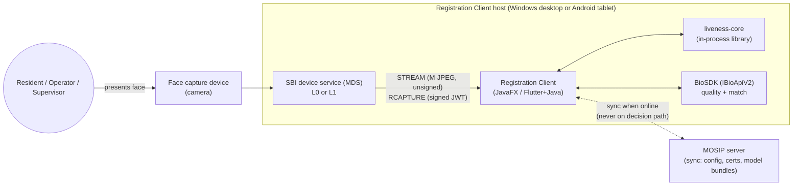

### 6.2 Component architecture

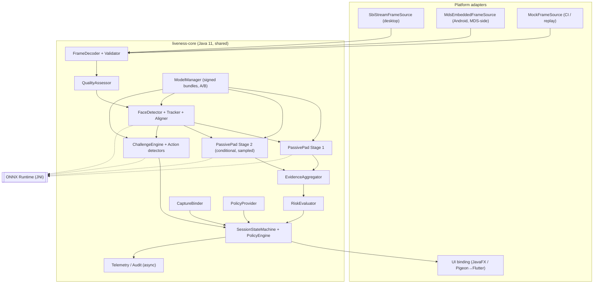

### 6.3 Frame-processing data flow and concurrency

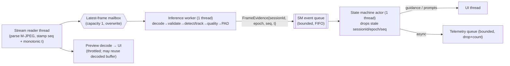

- **Latest-frame scheduling.** The mailbox holds at most one pending frame. If the worker is busy, newer frames overwrite older ones, so latency never accumulates in a queue. Dropped frames are counted and reported.
- **No out-of-order corruption.** Every evidence item carries `(sessionId, epoch, frameSeq, tMono)`. The state machine rejects items whose `sessionId` is not current, whose `epoch` is not current (the epoch increments on each retry, challenge issue and track reset), or whose `seq` is not greater than the last accepted one.
- **Critical path:** reader → mailbox → worker → state-machine actor.
- **Asynchronous:** telemetry, audit persistence, preview rendering, model bundle verification of the *inactive* slot, and metrics roll-ups.

### 6.4 Passive-to-active decision flow

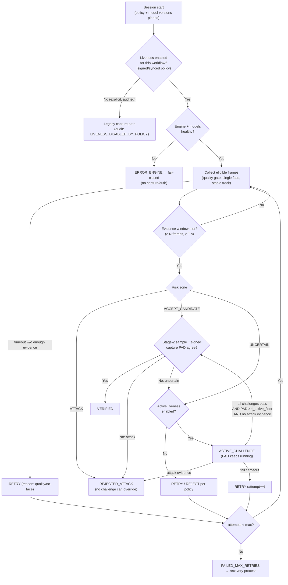

### 6.5 Challenge-response sequence

```mermaid
sequenceDiagram
  autonumber
  participant UI as UI
  participant SM as StateMachine
  participant CE as ChallengeEngine
  participant W as InferenceWorker
  participant DEV as SBI stream
  SM->>CE: issue(sessionId, epoch, capabilities, policy)
  CE->>CE: CSPRNG pick sequence (no repeats, capability-filtered, random hold/jitter)
  CE-->>SM: Challenge{id, type, issuedAtMono, deadline, guardMs}
  SM->>SM: epoch++ (invalidate prior evidence for action detection)
  SM->>UI: prompt("Please turn your head to the left")
  loop frames until deadline
    DEV->>W: frame(seq, tMono)
    W->>SM: Evidence{epoch, seq, tMono, landmarks, padScore}
    SM->>SM: discard if tMono < issuedAt + guardMs or stale epoch
    SM->>CE: update(baseline → onset → peak → return)
    SM->>SM: PAD running aggregate; attack check
    SM-->>UI: feedback ("Please continue" / "Hold still")
  end
  alt action observed with onset after issue, PAD ok
    CE-->>SM: PASSED(challengeId)
    SM->>UI: "Action detected"
  else timeout / wrong action / track break
    CE-->>SM: FAILED(reason)
  else PAD attack evidence at any time
    SM->>SM: REJECTED_ATTACK (terminal for this attempt)
  end
```

### 6.6 Desktop integration

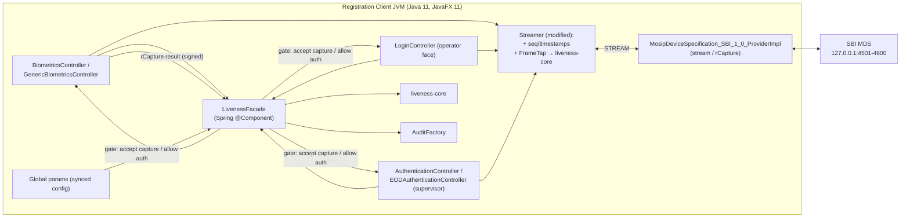

### 6.7 Android integration (recommended: MDS-embedded liveness)

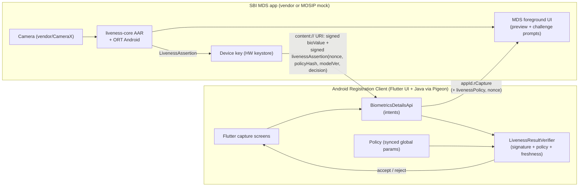

### 6.8 Offline operation

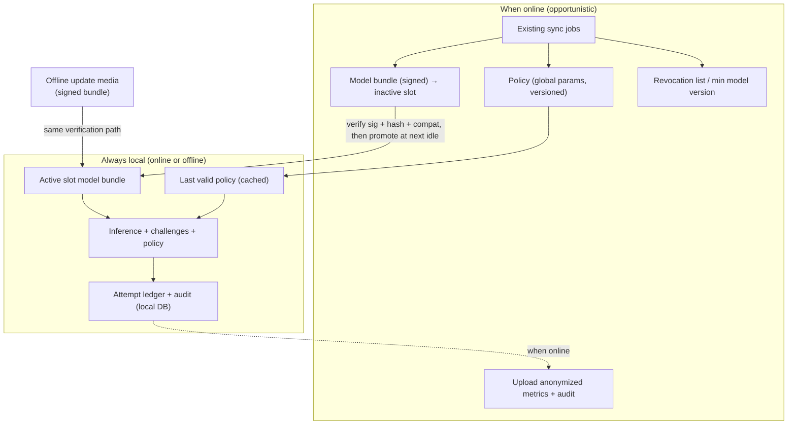

### 6.9 Model update and rollback

```mermaid
sequenceDiagram
  autonumber
  participant SRV as MOSIP server / USB media
  participant MM as ModelManager
  participant SA as Slot A (active)
  participant SB as Slot B (inactive)
  participant AUD as Audit
  SRV->>MM: bundle vN (manifest.json + .onnx + manifest.sig)
  MM->>MM: verify signature (trusted cert from existing cert sync)
  MM->>MM: verify SHA-256 of each file; engineMin ≤ engine; version ≥ minAllowed
  alt verification fails
    MM->>AUD: MODEL_BUNDLE_REJECTED(reason)
  else ok
    MM->>SB: install vN
    MM->>SB: load + golden-vector self-test (fixed inputs → expected outputs ± tol)
    alt self-test fails
      MM->>AUD: MODEL_SELFTEST_FAILED
    else pass
      MM->>MM: swap active pointer at next idle (never mid-session)
      MM->>AUD: MODEL_ACTIVATED(vN, prev=vN-1)
    end
  end
  Note over MM,SA: Rollback = re-activate the retained previous slot,<br/>allowed only if its version ≥ server-signed minAllowedVersion
```

### 6.10 Error recovery

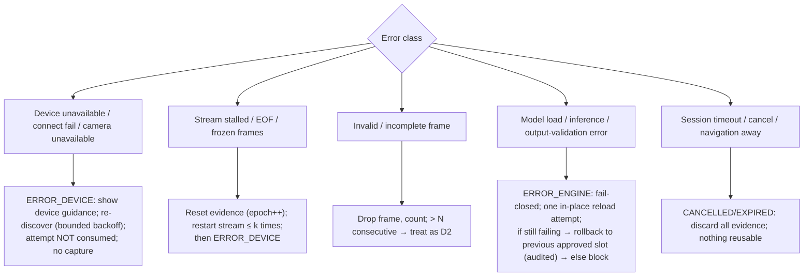

### 6.11 Security trust boundaries

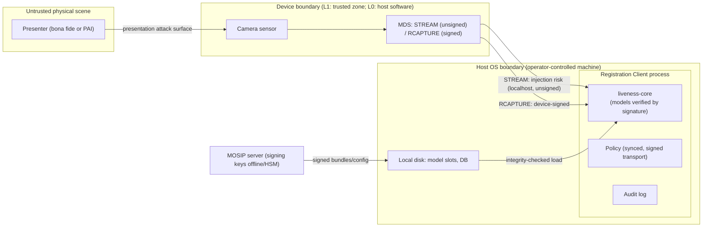

---

## 7. Critical-path latency analysis

### 7.1 Measurement points

All points use a monotonic clock (`System.nanoTime`). Per-stage spans are stored as HDR-style histograms, and no frames are retained.

| Span | Start → End | Notes |
|---|---|---|
| `t_acq` | Last byte of JPEG chunk read → frame published to mailbox | Excludes device-internal latency, which cannot be observed without a calibration rig (§13.3) |
| `t_queue` | Published → taken by worker | Should be ≈ 0 with latest-frame scheduling. Also count drops |
| `t_decode` | JPEG → RGB buffer | |
| `t_validate+quality` | | |
| `t_detect_track` | Detection (on detect frames) or track update | Report detect and track frames separately |
| `t_pad1`, `t_pad2` | Preprocessing (crop/resize/normalize) + `session.run` + output validation | Split preprocessing vs. `run` |
| `t_agg+policy` | Evidence aggregation + state-machine transition | |
| **`t_passive_frame`** | Worker take → evidence delivered to state machine | **This is the "p95 ≤ 100 ms" metric** |
| `t_decision_passive` | Session start (first eligible frame) → VERIFIED/UNCERTAIN | Dominated by fps and the evidence window |
| `t_challenge_i` | Prompt shown → challenge PASSED/FAILED | Human reaction + action time |
| `t_bind` | RCAPTURE response received → binding verdict | |
| **`t_total`** | User-visible start → final result | Reported per workflow and per path (passive-only vs. active) |

### 7.2 Budgets and targets (to validate)

**Reference desktop CPU (proposed):** 4-core/8-thread x86-64 with AVX2, no VNNI, about 2018–2020 laptop class (e.g. Intel Core i5 8th-gen U-series), 8 GB RAM, Windows 10/11 x64, no GPU.

This must be reconciled with MOSIP's published hardware minimums and the actual registration-kit hardware [UNVERIFIED]. We pick a non-VNNI CPU deliberately, so that int8 gains are not assumed.

| Metric | p50 target | p95 target | p99 target |
|---|---|---|---|
| `t_decode` (640×480 JPEG) | ≤ 5 ms | ≤ 10 ms | ≤ 15 ms |
| `t_detect` (detect frame) | ≤ 6 ms | ≤ 12 ms | ≤ 20 ms |
| `t_pad1` | ≤ 8 ms | ≤ 15 ms | ≤ 25 ms |
| `t_pad2` (when run) | ≤ 15 ms | ≤ 30 ms | ≤ 45 ms |
| **`t_passive_frame`** | ≤ 35 ms | **≤ 60 ms (budget); ≤ 100 ms (hard target)** | ≤ 150 ms |
| `t_bind` (excl. BioSDK match) | ≤ 40 ms | ≤ 80 ms | ≤ 120 ms |
| `t_decision_passive` @ 15 fps | ≤ 1.2 s | ≤ 2.0 s | ≤ 3.0 s |
| `t_decision_passive` @ 3 fps | ≤ 2.0 s | ≤ 3.0 s | ≤ 4.0 s |
| `t_challenge_i` (per challenge, human-in-loop) | ≤ 2.5 s | ≤ 5 s | timeout (configurable, default 8 s) |
| `t_total` passive path | ≤ 2 s | ≤ 3.5 s | ≤ 5 s |
| `t_total` with 2 challenges | ≤ 7 s | ≤ 12 s | ≤ 20 s |

| Resource | Desktop target | Android (MDS-embedded) target |
|---|---|---|
| Model bundle on disk | ≤ 20 MB | ≤ 12 MB |
| Resident memory increase during session | ≤ 150 MB | ≤ 80 MB |
| Memory growth over an 8 h soak | < 5% after warm-up | < 5% |
| CPU during session @ 15 fps | ≤ 50% of total cores (avg) | ≤ 60% of big cores (avg); no thermal throttling in a 10 min session |
| Cold start (load + verify + warm-up) | ≤ 1.5 s p95, done in background at app start | ≤ 2.5 s p95 |
| Sustained throughput | ≥ 15 eligible frames/s processed with Stage 1; never below device fps up to 15 fps | ≥ 8 fps |

### 7.3 Latency techniques (each must be profiled; none assumed)

- **Load once, reuse.** Keep one `OrtSession` per model for the app lifetime. Warm up with 3–5 dummy inferences at load time, since the first-run latency includes allocator and kernel selection. Session creation is never on the critical path.
- **Avoid copies.**
  - *Status quo:* `Streamer` decodes each JPEG into a JavaFX `Image`, and we must not decode the same JPEG twice. Proposal: decode once to a pooled RGB `ByteBuffer`, and build the preview `WritableImage` from that buffer at a throttled rate (≤ 15 Hz).
  - *Reuse buffers:* preallocate direct `FloatBuffer`s for model inputs and reuse `OnnxTensor` wrappers where the ORT Java API allows. The pool is sized to in-flight frames, which is 1–2.
  - *Status quo:* the M-JPEG parser reads byte-by-byte from the socket. Proposal: wrap it in a `BufferedInputStream` and scan for SOI/EOI markers in bulk. Profile first.
- **Tracking between detections.** Run the detector every k-th frame (k tuned: 3–5 at 15 fps; 1 at ≤ 5 fps) and track with IoU plus landmark continuity in between. Force detection on low tracking confidence, and run a full-frame face count at least every `T_count` ms so a second face cannot hide in tracked frames.
- **Resizing and normalization.** Crop first, then resize the small ROI; never resize the full frame for PAD. Use a fixed interpolation (bilinear) identical to training. **Preprocessing parity between Python training and Java inference is a correctness requirement:** golden-vector tests compare within a tolerance (§15).
- **Batching.** Use single-frame inference on the live path, because batching adds wait time. Batching is used only for offline evaluation and for multiple crops of the same frame (e.g. Stage-1 multi-scale) when profiling shows a gain.
- **Threads.** Use a dedicated inference executor (1 thread) with ORT intra-op threads = **1** by default (v0.2: on M1, 1 and 2 threads were within run-to-run noise and 4 threads were consistently worse, p95 27–33 ms vs ~10–11 ms; re-verify on x86). Benchmark 1/2/4 threads, because the JavaFX UI, stream reader and BioSDK share the CPU. Disable or bound spinning (`spin_duration_us`, `spin_backoff_max`) if CPU contention is measured. Keep `ORT_SEQUENTIAL`, since the candidate models are not branchy.
- **Quantization.** Static QDQ S8S8 is a candidate *experiment*. It ships only if both of these hold:
  - (a) measured speed-up on the reference CPU (non-VNNI parts may see none or a slowdown);
  - (b) per-PAI APCER and BPCER on the full evaluation set do not regress beyond equivalence margins (e.g. Δ ≤ 0.5 pp, CI-backed).
  Stage-2 FP32 is acceptable if it is not needed per frame.
  **v0.2 result:** for MiniFASNet, post-training INT8 failed *both* conditions: it was slower on M1 (PAD 6.5 vs 3.8 ms), and it flipped 5–7% of decisions, 26 of 32 of them toward *more permissive* at the attack-veto threshold. INT8 is rejected unless a model is trained quantization-aware and passes a decision-flip test.
- **Hardware acceleration.**
  - *Desktop:* CPU EP default. DirectML/OpenVINO EPs are optional, ship only after parity tests, and need a CPU fallback with identical thresholds.
  - *Android:* XNNPACK or CPU. NNAPI is not used (deprecated). Vendor NPUs via QNN only for specific certified kits.
- **Frame sampling.** Processing every frame is unnecessary when fps exceeds the throughput target; the latest-frame mailbox self-throttles. **Evidence windows are defined in frames *and* seconds,** so throttling cannot shorten the security evidence requirement.
- **Parallel vs. sequential.** Stage 1 and Stage 2 run sequentially on the same worker. Running them in parallel would raise CPU contention with the UI. Revisit only if profiling shows idle cores *and* p95 pressure.

### 7.4 Stale and out-of-order protection

The session/epoch/sequence tagging is described in §6.3. In addition:

1. Results arriving after a session ends are discarded and counted as `late_result`.
2. The challenge evaluator only accepts evidence with `tMono ≥ issuedAt + guardMs`. `guardMs` is at least the measured device pipeline latency p99 (§13.3), with a conservative default of 300 ms until measured.
3. **Onset requirement:** the challenge passes only on a *transition* observed after issue (baseline → action), never on a state already present (e.g. a pre-existing smile or turned head).
4. **Signed RCAPTURE timestamp:** this is device time; the SBI says the device syncs time from its management server. It must fall within `[sessionStart − skewTol, now + skewTol]`. Otherwise the capture is rejected as stale (`CAPTURE_STALE`).

---

## 8. Model-selection strategy

### 8.1 Candidate pool

| Role | Candidates | Selection criteria |
|---|---|---|
| Face detection | YuNet (OpenCV zoo, ONNX); BlazeFace (MediaPipe) | Recall at registration distances, false multi-face rate, latency, licence |
| Landmarks / blendshapes (challenges + pose) | MediaPipe Face Landmarker (Android native); an ONNX-exported 468/478-point mesh model or a small 68/98-point model for desktop | Same model family on both platforms preferred (parity). Licence per model card |
| Stage-1 PAD | MiniFASNet-class (Apache-2.0 baseline); our own retrained MobileNetV3/EfficientNet-Lite-class with auxiliary (pixel-wise / Fourier) supervision | Per-PAI APCER at BPCER 5% on **target-device** data, latency, size |
| Stage-2 PAD | CDCN-style or DeepPixBiS-style texture model on a wider context crop; optionally distilled from a large DG teacher (FLIP-style CLIP-ViT) offline | **Error diversity with Stage 1** (low correlation of errors), leave-one-PAI-out results |

**Rejected for the critical path:** rPPG (fps), 3D-CNN/transformer temporal models (CPU), and any InsightFace pre-trained weights, which are licensed for non-commercial research only [verify per model]. Also rejected: any model whose training-data licence forbids deployment.

### 8.2 Data strategy (the biggest accuracy lever)

Public FAS datasets (OULU-NPU, SiW, SiW-M, CASIA-SURF, CelebA-Spoof, Replay-Attack) are almost all **research-only / non-commercial licensed**. They can be used for research benchmarking, subject to licence terms. They are **not** a legal basis for a deployed model unless the licence permits it.

**Production requires a consented, purpose-specific collection on the actual SBI devices:**
- bona fide data across lighting, skin tone (Monk Skin Tone or Fitzpatrick annotations), age, eyewear, headwear and facial hair;
- attack data: the PAI species in §14.2, recorded through the **SBI stream path** with its real JPEG compression and resolution.

### 8.3 Training recipe (hypotheses to test)

- Domain-generalization training (SSDG/SAFAS-style), treating devices and lighting as domains.
- Auxiliary supervision (pixel-wise maps, Fourier spectrum).
- Colour-preserving inputs; augmentation for JPEG quality, resolution, blur, white balance and gamma.
- Calibration per device profile on held-out validation subjects.
- Optional distillation from a heavy offline teacher.

### 8.4 Fusion and conditional execution

- **Fusion rule (initial):** conservative.
  - Accept requires `agg(s1) ≥ τ1_accept` **and**, where Stage 2 ran, `agg(s2) ≥ τ2_accept`.
  - Attack is declared if either model's attack evidence exceeds its `τ_attack`, with the counting rule in §10.
  - A learned fusion (logistic regression on both scores plus quality) is evaluated against this baseline and adopted only if it improves per-PAI APCER at equal BPCER.
- **Conditional floor (security-critical).** A purely uncertainty-triggered Stage 2 is attacker-steerable: a PAI that fools Stage 1 confidently would never be examined by Stage 2. Stage 2 therefore always runs on:
  - (a) at least `stage2.minSamples` (default 3) randomly chosen eligible frames per attempt;
  - (b) the signed RCAPTURE image;
  - (c) every frame while the zone is UNCERTAIN or ACTIVE.

---

## 9. Security threat model

The method is a STRIDE-style pass plus ISO/IEC 30107-1 attack categories. Assets: the integrity of the liveness decision, the bound signed capture, model and policy integrity, and subject privacy.

| # | Threat | Vector | Mitigation | Residual risk |
|---|---|---|---|---|
| T1 | Print attack (flat, curved, glossy/matte) | Physical | Stage 1/2 texture PAD; active challenges defeat static prints | Low–medium in-domain; higher on unseen print media |
| T2 | **Cut-out print** (eye/mouth holes, real eyes behind) | Physical | PAD texture on the paper region; blink/smile alone **insufficient**, so head-turn challenges add 3D/parallax evidence | **Medium** (RGB) |
| T3 | Screen photo (phone/tablet/monitor) | Physical | Moiré, bezel and context (Stage 2 context crop) and specular cues | Medium; high-PPI screens + JPEG stream compression may erase moiré |
| T4 | Video replay (passive) | Physical | PAD + challenges (replay does not follow random prompts) | Low–medium |
| T5 | **Interactive replay**: pre-recorded clips of each challenge, switched by the attacker | Physical | Small challenge entropy (e.g. 4 types, 2 challenges ≈ 12 orderings) is **not** a cryptographic defence. Mitigations: random hold durations and inter-challenge gaps, onset timing checks, continuous PAD, track continuity (clip switching causes discontinuities) | **Medium–high** on RGB. PAD on the screen medium is the real defence |
| T6 | Real-time puppetry / deepfake **shown on a screen** | Physical | Same as T3/T5 | **High** on RGB with high-quality screens |
| T7 | **Injection**: virtual camera or modified MDS delivers synthetic frames on STREAM; replayed signed capture | Digital | Bind to *signed* RCAPTURE (P3); PAD on the signed image; device trust validation (existing); RCAPTURE timestamp window; L1 devices preferred for high-assurance workflows | **High for L0** (host-side encryption: host compromise = device compromise). Out of 30107 scope; see CEN/TS 18099 |
| T8 | Stream/capture **subject swap** (live person in stream, photo at RCAPTURE moment or vice versa) | Physical/digital | CaptureBinder: PAD on the signed image + subject-consistency check vs. the tracked face + time window | Low–medium |
| T9 | 3D masks (silicone/resin) | Physical | Out of reliable reach for RGB; motion/texture cues may help | **High.** Requires Architecture C hardware |
| T10 | Threshold or config tampering (lowering `τ_accept`, disabling liveness) | Local admin | Config via server-synced global params only; manifest bounds; audit on every policy change; policy hash in every result | Medium (local DB tamper by host admin) |
| T11 | Model substitution / rollback to a vulnerable model | Local | Signature + SHA-256 + server-signed `minAllowedVersion` | Low |
| T12 | Oracle attacks (iterating on UI feedback or scores) | Physical | Generic PAD-failure message (PS); no scores in UI; attempt ledger; attack-event counter escalates | Low–medium |
| T13 | Retry grinding (repeat until a lucky accept) | Physical | Max retries; policy never relaxes; attack events persist across retries within the subject session; per-workflow cooldown | Low |
| T14 | DoS (malformed frames, decompression bombs) | Digital | Size and dimension bounds before decode; bounded queues; per-frame time budget; fuzzing | Low |
| T15 | Privacy leakage (frames in logs/diagnostics) | Insider | No frame retention by default; diagnostics carry metadata only; authorized diagnostic capture is encrypted and time-boxed | Low |
| T16 | Demographic bias causing unequal false rejections | — | Per-group BPCER gates; calibration review | Medium until measured |
| T17 (v0.3) | **Unauthenticated stream**: same-subject video/deepfake injected on STREAM while the signed capture is a photo/screen of the subject | Digital | Subject consistency and temporal binding do **not** help (same subject); only PAD on the signed capture; L1 policy; future signed stream (B1–B3) or device-app liveness (A1) | **High** on SBI 1.0 (`STREAM_AUTHENTICITY_EVALUATION.md`) |
| T18 (v0.3) | Stream/capture timing games: capture released from outside the request window, stream paused or swapped during RCAPTURE | Digital | Signed timestamp within `[t_req − δ, t_resp] ± 5 s`; window coverage/gap/integrity/subject rules | Low–medium; a still-only swap during the capture window is **not detected** by default (characterization test VERIFIES); the proposed window rule is bypassable and costly (report §5.3) |
| T19 (v0.3) | Clock manipulation (host wall clock stepped, device clock skewed) to widen freshness windows | Local/digital | Monotonic windows; wall–mono drift → fail closed; tight window skew | Low; device clock offsets unmeasured (may cause false rejects) |
| T20 (v0.3) | Static-image replay on the stream (re-encoded, slightly transformed photo loop) | Digital/physical | `StaticReplayDetector`; never readies | Medium: [SIM]-only threshold, thin margins, still users falsely flagged |
| T22 (B1 prototype) | Stream statement forgery, replay or mismatch: tampered or foreign-key statement, statement from another session or transaction, statement naming another capture, gaps/reordering, stale statement | Digital | `StreamDigestVerifier` (signature + chain, signer = capture signer, nonce, transaction, capture hash, freshness, contiguous seq, chain head); failures are authentication failures, never attack verdicts | Low on the mock ([CODE][MOCK]); **requires an SBI change** for real devices; endpoint compromise out of scope |
| T23 (B1 prototype) | Frame substitution, replay or suppression on the stream channel when B1 is required | Digital | Hash at receipt; every evidence frame must be in the signed list, in order (bounded trailing exclusion); missing-in-window bound | Low–medium: tail suppression relies on the gap rule (U21) |
| T21 (v0.3) | Limit reset by restarting the client | Local | Ledger outside the session | **High until** the persistent ledger exists (D-MOS-7) |

**B1 prototype status (2026-10-24):** with `requireStreamAuthentication`, T17 same-person whole-stream replacement fails as an integrity failure on the mock (2/3 runs; 1/3 masked by capture PAD); with the default (B1 off) it VERIFIED 3/3. B1 does not change T1–T6/T9 (presentation attacks) or endpoint compromise. See `docs/phase1/B1_STREAM_DIGEST_DESIGN.md`.

**v0.3 status of earlier threats:** T7 — temporal binding, nonce/window checks and level policy implemented; stream substitution remains undetectable when the injected subject matches (T17). T8 — rejected end to end on the mock for a different-person swap (`SUBJECT_MISMATCH`); same-person photo swap relies on capture PAD (placeholder). T12/T13 — attack events and attempts persist across retries and sessions within one process only (T21).

**RGB-only attacks that remain hard:** T2, T6, T9, high-PPI screen attacks after stream compression, and T7 on L0 devices. These limits must appear in the deployment risk register; they are not engineering bugs.

---

## 10. Decision state machine and security invariants

### 10.1 States

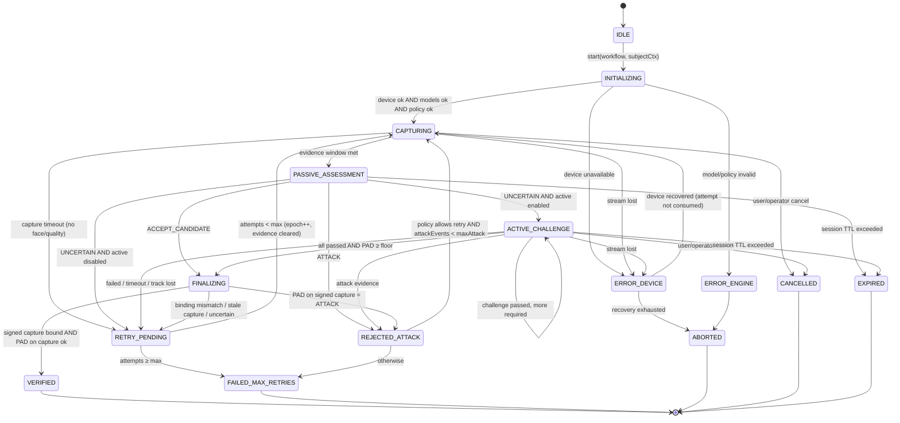

The state machine is a pure, single-threaded transition function `(state, event, policy) → (state', effects)`. It has no I/O, which makes it exhaustively unit-testable and allows property-based testing of the invariants.

### 10.2 Security invariants (enforced in code and tested)

| ID | Invariant | Enforcement |
|---|---|---|
| I1 | An ATTACK verdict in an attempt cannot be converted to VERIFIED by any later event in that attempt | `REJECTED_ATTACK` has no edge to `FINALIZING`/`VERIFIED`. `attackSeen` flag checked in `FINALIZING` |
| I2 | Missing, malformed, non-finite, out-of-range or wrong-shape model output never contributes positive evidence | `PadOutputValidator` → `ENGINE_ERROR` event. Aggregator counts only validated scores. Accept requires the minimum *validated* count |
| I3 | Retries never relax requirements | Policy pinned at session start. Thresholds for attempt n are identical to attempt 1. Evidence is cleared on retry (no carry-over of positive evidence); attack counters **carry over** |
| I4 | Challenges are unpredictable and session-bound | `SecureRandom`. Challenge id = random 128-bit, bound to `(sessionId, epoch)`. No API accepts an externally chosen challenge |
| I5 | Challenge responses use only fresh frames | `tMono ≥ issuedAt + guardMs`, plus onset-transition requirement, plus epoch match |
| I6 | Expired or stale sessions or results cannot authorize | Result objects carry `sessionId` + nonce. The consuming controller verifies they match its own open session. Late results are discarded |
| I7 | Retry limits enforced | `AttemptLedger` keyed by the workflow's subject context (registration id / operator id). Not resettable by UI navigation within the same subject session |
| I8 | Hardware or model failures fail closed | `ERROR_*` states have no path to `VERIFIED`. Recovery is explicit and audited |
| I9 | Liveness is never silently disabled offline | Enablement is read from cached synced policy; network state is not an input to the policy engine. A missing policy uses bundle defaults (enabled) |
| I10 | The verified result binds to the signed capture | `VERIFIED` requires `CaptureBinder` success. The result includes the hash of the signed RCAPTURE `data` |
| I11 | Thresholds are within manifest-declared secure bounds | `PolicyProvider` validation |
| I12 (v0.2) | Model inputs are produced by the single canonical preprocessing the thresholds were calibrated with | Golden-vector parity test (Java vs Python, exact) gates every model/preprocessing change |
| I13 (v0.2) | A capture is used only if its signed `transactionId` equals this request's unpredictable nonce, its signed timestamp is inside the session window, and its signed `digitalId` names the streaming device | `CaptureBinder` checks 4–6; device approval requires nonce echo |
| I14 (v0.2) | Byte-identical repeated frames never count as evidence | `FramePipeline` `FROZEN_FRAME` |
| I15 (v0.3) | Every stream evidence item (frame result, embedding) is tagged at arrival and accepted only through the session's `EvidenceGate`s | `LivenessSession.onEvidence` / `onEmbedding`; F2 tests |
| I16 (v0.3) | VERIFIED requires the RCAPTURE window `[t_req − δ_lat, t_resp]` to be covered by eligible, non-frozen, single-face, non-static, PAD-passing frames with ≥ 1 frontal embedding, and every frontal embedding of the attempt to match the capture | `LivenessSession.finishBound` (sole VERIFIED assignment) |
| I17 (v0.3) | A wall-clock discontinuity between attempt start and capture response fails closed; windows use monotonic time | `CLOCK_DISCONTINUITY`; F7 tests |
| I18 (v0.3) | A stream without temporal variation above the static threshold never reaches READY or VERIFIED | `StaticReplayDetector`; [SIM] fixtures |
| I19 (v0.3, review) | Attempt-wide decisions (subject consistency, attack-frame count) never depend on records the bounded store may evict; the attempt subject ledger never evicts and fails closed when full | `LivenessSession` subject ledger and attempt counters; eviction regression tests |
| I20 (v0.3, review) | Evidence timestamps are assigned by the session at frame receipt, or validated if supplied by the transport; time limits are enforced on every event | `tagArrival()`; per-event `enforceTimeouts()` |
| I21 (v0.3, review) | A session cannot be created with an invalid policy (unknown certification level, inconsistent thresholds or bounds); the policy is pinned at creation | `SessionPolicy.validate()` / `copy()` |

### 10.3 Uncertainty vs. confirmed attack

| Situation | Classification | Action |
|---|---|---|
| Aggregated score in `[τ_attack, τ_accept)` with good quality | **Uncertain** | Active challenge |
| Low quality, high score dispersion, few eligible frames, unstable track | **Insufficient evidence** (not an attack) | Guidance + continue capturing; on timeout → RETRY |
| ≥ `attack.minFrames` (default 3) validated frames below `τ_attack` within the window, **or** signed-capture PAD below `τ_attack` | **Attack detected** | `REJECTED_ATTACK`, generic message, audit with reason |
| A single frame below `τ_attack` | Not sufficient alone (guards against one-frame glitches) | Counted; moves zone to UNCERTAIN |

### 10.4 When to accept, challenge, retry, reject or escalate

- **Accept** — passive window met, ACCEPT_CANDIDATE, Stage-2 samples agree, and the signed capture is bound and passes PAD.
- **Challenge** — UNCERTAIN and active is enabled for the workflow.
- **Retry** — insufficient evidence, challenge failed or timed out, or binding failed. Each retry costs one attempt.
- **Reject** — an attack is detected. Retry is allowed only if the workflow policy permits it and `attackEvents < maxAttackEvents`. Proposed defaults: resident: allow 1; operator and supervisor: 0, go straight to recovery.
- **Escalate** — max retries or attack events exceeded → `FAILED_MAX_RETRIES` with the configured `repeatedFailureAction`. See §10.6.

### 10.5 Reason codes (mapping the PS error list)

| PS error | Reason code | State | UI message (generic where security-relevant) |
|---|---|---|---|
| Device unavailable / connection failure / camera unavailable | `DEVICE_UNAVAILABLE`, `DEVICE_CONN_FAILED`, `CAMERA_UNAVAILABLE` | ERROR_DEVICE | Device guidance |
| Face not detected | `NO_FACE` | CAPTURING (guidance) → RETRY on timeout | "Keep your face within the capture area" |
| Multiple faces | `MULTIPLE_FACES` | Evidence reset | "Only one person should be in view" |
| Poor face quality | `LOW_QUALITY_{DARK,BRIGHT,BLUR,POSE,SMALL}` | CAPTURING (guidance) | Lighting/position guidance |
| Liveness below threshold | `PASSIVE_UNCERTAIN` | ACTIVE_CHALLENGE or RETRY | "Please follow the instruction" |
| PAD failure | `PAD_ATTACK` | REJECTED_ATTACK | "Face verification could not be completed. Please try again." |
| Active challenge failure | `CHALLENGE_FAILED` | RETRY | "We could not verify face liveness. Please try again." |
| Challenge timeout | `CHALLENGE_TIMEOUT` | RETRY | Same + "Follow the prompted action" |
| Max retries | `MAX_RETRIES` | FAILED_MAX_RETRIES | Recovery guidance |
| Invalid/incomplete frames | `INVALID_FRAME` (counted) → `STREAM_CORRUPT` | Drop → ERROR_DEVICE | Device guidance |
| Liveness engine errors | `ENGINE_ERROR`, `MODEL_INTEGRITY` | ERROR_ENGINE | "Face verification is temporarily unavailable" |
| (proposed) | `CAPTURE_STALE`, `CAPTURE_SUBJECT_MISMATCH` | RETRY | Generic |

### 10.6 Recovery process (needs a product/policy decision)

`repeatedFailureAction` per workflow, with proposed options:

- **Resident** (`supervisorReview` or `block`):
  - `block` — no face captured. The registration cannot complete face capture in this session.
  - `supervisorReview` — requires supervisor biometric authentication, *which itself requires liveness*, plus a mandatory reason. The packet is flagged with `livenessOverride=true` for server-side manual adjudication. This flag is **proposed** and needs a MOSIP packet-metadata decision.
- **Operator/supervisor** (`fallbackModality` or `block`): fall back to another configured authentication modality (fingerprint/iris/password per existing MOSIP auth config), with the face-liveness failure audited. **Never** "accept the face without liveness".

---

## 11. Desktop and Android integration strategy

### 11.1 Language/runtime decision

| Option | Pros | Cons | Decision |
|---|---|---|---|
| **Java 11 core + ONNX Runtime Java** | One codebase for Desktop and Android; same ORT Java API (`ai.onnxruntime`) on both; fits Java 11 desktop stack and Android Java modules; no extra process | JNI crash surface; Java preprocessing speed must be measured | **Selected** |
| C++ core (ORT C++ + OpenCV) behind JNI | Fastest preprocessing; identical numerics across platforms | Two JNI builds (Win x64, Android arm64/x86_64), heavier CI, harder for MOSIP Java maintainers | Fallback if Java preprocessing exceeds budget |
| Kotlin core | Good on Android | Adds Kotlin runtime to desktop; no clear benefit | Rejected |
| Python sidecar | Fast research iteration | Packaging, process lifecycle, localhost IPC attack surface, Android infeasible | **Research harness only** |
| Vendor SDK only | Possibly certified PAD | Vendor lock-in conflicts with PS vendor independence; opaque | Supported **behind the same SPI** as an alternative `PadModel`/`LivenessEngine` implementation |

### 11.2 Core interfaces (Java, illustrative)

```java
// ---- Device side -------------------------------------------------------
public interface FaceFrameSource extends AutoCloseable {
    DeviceCapabilities capabilities();                 // fps (declared + measured), resolution, formats,
                                                       // supportsStream, supportsChallengeUi, channels {RGB[,DEPTH,NIR]}
    void start(FrameSink sink, StreamRequest req) throws DeviceException;
    void stop();
}
public interface FrameSink {
    void onFrame(EncodedFrame frame);                  // seq, tMonoNanos, wallClock, mime, ByteBuffer (read-only)
    void onDeviceEvent(DeviceEvent event);             // CONNECTED, DISCONNECTED, STALLED, ERROR(code)
}

// ---- Liveness side -----------------------------------------------------
public interface LivenessEngine {
    EngineStatus status();                             // READY / DEGRADED / UNAVAILABLE (+ model & policy versions)
    LivenessSession open(SessionRequest req);          // workflow, subjectContextId, policy snapshot, capabilities
}
public interface LivenessSession extends AutoCloseable {
    void submitFrame(EncodedFrame frame);              // non-blocking; latest-frame mailbox
    void submitSignedCapture(SignedFaceCapture c);     // RCAPTURE bioValue + signed data hash + device timestamp
    void cancel(CancelReason reason);
    SessionId id();
}
public interface LivenessListener {                    // delivered on the state-machine thread; UI must marshal
    void onState(LivenessState state, GuidanceCode guidance, Progress progress);
    void onChallenge(ChallengePrompt prompt);          // type, localized key, deadline
    void onResult(LivenessResult result);
}
public final class LivenessResult {                    // immutable
    SessionId sessionId; Decision decision;            // VERIFIED, RETRY_AVAILABLE, REJECTED, FAILED_MAX_RETRIES, ERROR
    ReasonCode reason; int attempt; int maxAttempts;
    String modelBundleVersion; String policyVersion; String policyHash;
    byte[] signedCaptureDataHash;                      // binds to RCAPTURE (I10)
    StageTimings timings;                              // no biometric content
}

// ---- Model SPI (enables vendor or multimodal PAD later) ----------------
public interface PadModel {
    PadModelInfo info();                               // id, version, input spec, channels, calibration profile ids
    PadOutput infer(AlignedFace face) throws PadInferenceException; // validated output or exception, never a default
}
```

### 11.3 Desktop integration plan (verified hook points)

1. **`Streamer`** (`controller/device/Streamer.java`):
   - add sequence numbers and monotonic timestamps;
   - replace byte-wise parsing with buffered parsing, after profiling;
   - add a `FrameTap` callback that forwards each `EncodedFrame` to the active `LivenessSession`;
   - keep the preview, driven from the shared decoded buffer.
2. **New `LivenessFacade`** (Spring `@Component` in `registration-services`): owns the `LivenessEngine` singleton, opens sessions per capture or auth attempt, and adapts results to controllers and audit.
3. **Resident capture** (`BiometricsController`, `GenericBiometricsController`):
   - open a session before `bioService.getStream(...)`;
   - on `rCaptureTaskService` success, pass the face `BiometricsDto` to `submitSignedCapture` and **do not accept** the capture into the registration DTO until `LivenessResult.decision == VERIFIED` with a matching data hash;
   - if the device returns RCAPTURE before liveness completes, hold the result; the client may re-issue RCAPTURE after VERIFIED if the held capture fails binding;
   - challenge prompts appear in the existing capture pop-up; the stored face image remains the signed RCAPTURE (neutral pose), never a challenge frame.
4. **Operator face login** (`LoginController` ~L602–672): wrap the face path in a session with the `operator` policy profile. Proceed to `AuthenticationServiceImpl` matching only after VERIFIED. The match must use the same signed capture that was bound.
5. **Supervisor/EOD auth** (`AuthenticationController`, `EODAuthenticationController`): same, with the `supervisor` profile.
6. **Config:** new global params, read via the existing application map:
   ```
   mosip.registration.face.liveness.enabled=true
   mosip.registration.face.liveness.{resident|operator|supervisor}.enabled
   mosip.registration.face.liveness.{wf}.passive.threshold        # τ_accept, model-calibrated scale
   mosip.registration.face.liveness.{wf}.attack.threshold         # τ_attack (proposed)
   mosip.registration.face.liveness.{wf}.active.enabled
   mosip.registration.face.liveness.{wf}.active.min.challenges
   mosip.registration.face.liveness.{wf}.active.challenge.types   # BLINK,SMILE,TURN_LEFT,TURN_RIGHT,LOOK_UP,...
   mosip.registration.face.liveness.{wf}.active.challenge.timeout.ms
   mosip.registration.face.liveness.{wf}.max.retries
   mosip.registration.face.liveness.{wf}.max.attack.events
   mosip.registration.face.liveness.{wf}.repeated.failure.action  # block|supervisorReview|fallbackModality
   mosip.registration.face.liveness.diagnostic.enabled=false
   ```
   How these interact with the existing `num_of_face_retries` and `face_threshold` needs a decision: keep them for quality, and keep liveness separate.
7. **Audit:** new `AuditEvent` constants (`FACE_LIVENESS_START`, `..._VERIFIED`, `..._ATTACK`, `..._RETRY`, `..._MAX_RETRIES`, `..._ENGINE_ERROR`, `..._POLICY_DISABLED`, `MODEL_ACTIVATED`, ...) via the existing `AuditFactory`.

**Unresolved desktop risks:**
- actual stream fps and resolution of target devices;
- whether MDS implementations allow STREAM and RCAPTURE concurrently on all vendors (the current code assumes so);
- RCAPTURE capture-moment semantics (best-frame selection inside the device);
- device clock skew.

### 11.4 Android integration (decision required)

**Fact:** the Android client receives no frames. The SBI Android draft shows the stream in the MDS app's foreground UI [STD][CODE].

| Option | Description | Security | Effort | Dependency |
|---|---|---|---|---|
| **A1 (recommended): MDS-embedded liveness** | The MDS app embeds `liveness-core` AAR, runs passive+active in its foreground UI, and returns a **signed `LivenessAssertion`** (sessionNonce from client, policyHash, modelVersion, decision, reason, timestamps, capture-data hash) alongside the signed RCAPTURE | Best: evidence and capture originate inside the device trust boundary (L1: hardware keystore) | Medium; requires an SBI extension (request params: `livenessPolicy`, `nonce`; response: `livenessAssertion`) and vendor adoption | MOSIP SBI spec change; vendor cooperation. **MOSIP mock MDS** for the hackathon |
| A2: SBI frame-stream extension to the client | New bound-service or content-provider stream from MDS to client; client runs `liveness-core` | Weaker: frames cross an app boundary; need signing or attestation | High (spec + both apps) | Spec change |
| A3: Client-owned CameraX path | Client captures frames from the tablet camera itself for liveness, then calls SBI rCapture | **Weak binding:** two pipelines and a possibly different camera. Conflicts with device-trust model; camera contention with MDS | Medium | Only valid where the "device" is the built-in camera *and* MOSIP accepts it |

**Recommendation:** A1. The client side adds `LivenessResultVerifier`, which checks:
- the signature against the trusted device certificate chain (reusing existing device-trust validation);
- nonce equality;
- `policyHash` equal to the client's current policy;
- timestamp window;
- `captureDataHash` equal to the hash of the returned signed capture.

The Flutter UI shows the outcome, guidance and retry/max-retry flows. Prompts are rendered in the MDS UI, because it owns the foreground. That requires UX consistency guidelines shared with vendors — a real UX risk, since the PS wants consistent Desktop/Android UX.

**Shared between Desktop and Android:** all of `liveness-core`: decoder interfaces, quality, detection/tracking, PAD, aggregation, challenges, state machine, policy validation, model manager, telemetry schema, and the reason-code/guidance-code catalogue. Platform-specific: frame source, JPEG/YUV decoding, UI rendering, keystore/signing, packaging.

### 11.5 UI behaviour (both platforms)

The UI maps `GuidanceCode`s to localized strings. It never shows scores or model names except in authorized diagnostic mode. The progress indicator advances on validated evidence, not on time. Retry availability and remaining attempts are shown. PAD failures always show the generic PS message.

---

## 12. Offline deployment design

- **Everything on the decision path is local:** frames, models, policy, challenge generation, verification and audit. A network-state change during a session has no effect.
- **Policy:** cached last-valid synced global params. If none exists (first boot before sync), use the **signed bundle defaults**, which have liveness enabled; the client never treats a missing policy as "disabled".
- **Models:** shipped with the client installer (desktop) or the MDS app (Android). They are updated via (a) the existing online sync channel or (b) signed offline media, through the identical verification path (§6.9).
- **Time:** the offline host clock may drift. Freshness checks use the monotonic clock within a session. Comparisons with signed device timestamps use a configurable skew tolerance, and skew violations are audited rather than silently ignored.
- **Audit and metrics** queue locally (bounded, encrypted at rest with the client DB) and upload on the next sync.

---

## 13. Performance benchmark plan

### 13.1 Harness

- **Replay-driven benchmark.** Recorded M-JPEG streams (consented, bona fide + attack) are played through `MockFrameSource` at controlled fps (3, 10, 15, 30). They exercise exactly the production code path; only the source differs.
- **Microbenchmarks.** JMH for decode, preprocessing, each `session.run`, and the state machine.
- **Live-device benchmark.** The real SBI device on reference hardware.

### 13.2 Protocol

- Warm-up of 30 s, then measure ≥ 10,000 frames per configuration.
- Report p50/p95/p99/max and CPU% (process and system), RSS, GC pauses and dropped-frame ratio.
- Matrix: {1, 2, 4} intra-op threads × {FP32, QDQ-int8} × {Stage 2 sampled, Stage 2 every frame} × {background load: idle, a synthetic packet-encryption job}.
- Pinned versions (JDK, ORT, models) and power plan recorded. Results stored with a run manifest.
- **Regression rule:** CI fails if p95 `t_passive_frame` regresses > 10% against the stored baseline on the reference runner.

### 13.3 Device pipeline latency calibration

Use a screen-flash or LED rig in front of the device and measure the time until the change appears in received frames. This gives the device's p50/p99 pipeline latency, which sets `guardMs` per device profile.

### 13.4 Soak and stability

- 8 h continuous sessions with randomized workflows: no leak (RSS slope ≈ 0 after warm-up), no thread growth, no file-handle growth.
- 1,000 session open/close cycles; 500 device disconnect/reconnect cycles.

---

## 14. PAD accuracy and generalization evaluation plan

### 14.1 Data splits

- **Subject-disjoint** train / validation / test. No subject appears in more than one split.
- **Device-disjoint and PAI-disjoint** hold-outs for generalization.
- Thresholds are selected **only on validation data** and frozen before touching test data.
- Public datasets: cross-dataset (train on A, test on B) and leave-one-dataset-out (MCIO/OCIM-style) for research comparability only, within licence terms.

### 14.2 Presentation attack instruments (PAI species)

| Family | Species (each reported separately) |
|---|---|
| Print | Laser on plain paper; inkjet on photo paper (glossy, matte); curved/bent print; **cut-out eyes/mouth** |
| Screen (still) | Smartphone (≥ 2 models, incl. high-PPI OLED); tablet; laptop/monitor |
| Video replay | Smartphone; tablet; monitor; **replay containing scripted blink/smile/turn clips** |
| Interactive replay | Operator-switched clips responding to prompts (red team) |
| Other (stretch) | Paper mask; 3D mask; real-time face reenactment on a screen (red team; documented as out-of-reach expected) |

### 14.3 Metrics (ISO/IEC 30107-3-aligned, to be checked against the 2023 text)

- **APCER per PAI species** at the operating threshold; report the **maximum over species** (worst case), never only an average.
- **BPCER** at the operating threshold, overall and per demographic group (skin tone, sex, age band, eyewear), per device and per lighting condition.
- **BPCER at fixed APCER** (e.g. BPCER@APCER = 1%, 5%, 10%) and DET curves per species.
- **System-level metrics** (full pipeline incl. challenges and retries), reported separately from PAD-subsystem metrics:
  - attack acceptance rate per species within the max-retry budget;
  - bona fide **first-attempt** and **within-retries** rejection rate;
  - mean attempts to success.
- For operator and supervisor authentication: **IAPMR** (impostor attack presentation match rate), i.e. attacks accepted by both PAD and the matcher.
- **ACER** only for comparison with academic results, never as a release metric, because averaging hides the worst PAI.
- **Statistical confidence:** Clopper-Pearson 95% intervals. By the rule of three, zero errors in N attack presentations bounds the error at ≈ 3/N with 95% confidence. Supporting an APCER ≤ 5% claim per species needs ≥ 60 error-free presentations per species, and ≤ 1% needs ≥ 300. Plan collection sizes accordingly, and account for multiple presentations per subject (not independent).

### 14.4 Generalization studies

- Leave-one-device-out, leave-one-lighting-out and leave-one-PAI-out.
- JPEG quality sweep (SBI stream compression), resolution sweep, blur sweep.
- Model-diversity analysis: correlation of Stage-1 and Stage-2 errors per species, to justify Stage 2.

---

## 15. Testing strategy

| Layer | Tests |
|---|---|
| Unit | State-machine transitions (exhaustive table); invariants I1–I11 as property-based tests (random event sequences never reach VERIFIED after ATTACK, with invalid output, after expiry, etc.); challenge CSPRNG distribution; output validators; policy bounds |
| Numerical parity | Golden vectors: the same input image through Python reference and Java core → crops, tensors and scores within tolerance (e.g. max abs diff ≤ 1e-4 FP32), desktop and Android |
| Contract | `FaceFrameSource` contract suite run against mock SBI, each vendor adapter and the MDS-embedded adapter |
| Component | Replay of recorded sessions → expected decisions (bona fide accepted, each PAI rejected, challenge pass/fail) |
| Fault injection | Disconnect mid-session; stalled stream; frozen identical frames; corrupt/truncated JPEG; oversize frames; model file corruption; ORT exception; NaN outputs; clock skew; RCAPTURE before or after liveness; late results after cancel; config out of bounds |
| Security regression | Attack corpus + red-team scripts re-run on every model, threshold or code change; the release blocks on any per-species regression beyond margin |
| Fuzzing | JPEG/M-JPEG parser and decoder (Jazzer for Java); SBI response parsing |
| E2E | Desktop: TestFX-driven resident/operator/supervisor flows with mock SBI. Android: instrumented tests with mock MDS app |
| Offline | Full suite with networking disabled; policy-missing first-boot case |
| Performance | §13 suites in CI (reference runner) |
| Privacy | Assert no image bytes in logs/audit (scan for JPEG/PNG magic, base64 blobs); diagnostic mode gated |

---

## 16. Operational lifecycle

- **Model bundle format:** `manifest.json` + `*.onnx` + `manifest.sig`. The manifest holds:
  - `bundleVersion` (semver), `engineMin`, model ids and SHA-256s, input specs;
  - per-device-profile calibrated thresholds and their **allowed bounds**;
  - PAI coverage statement, evaluation-report hash, `minAllowedVersion` hint.
  Each bundle is signed by a MOSIP-controlled key, whose certificate is distributed through the existing cert sync. The key is held offline or in an HSM.
- **Integrity:** verify the signature and hashes at install *and* at every load. A failure means refusal to load, i.e. fail-closed.
- **Versioning and compatibility:** an engine only loads bundles with a compatible `engineMin` and input specs. Thresholds travel with the bundle (they are model-specific). A policy threshold set for a different bundle major version is rejected in favour of bundle defaults, with an alert.
- **Rollback:** an A/B slot. Only the immediately previous *approved* bundle can be restored, and only if it is ≥ the server-signed `minAllowedVersion` (anti-rollback).
- **Config versioning:** the policy carries `policyVersion` + hash, recorded in every result and audit event.
- **Audit without biometrics.** Allowed fields:
  - session id (random), workflow, subject-context id (already in MOSIP audit);
  - device make/model/serial-hash from the signed `digitalId`;
  - observed fps; frame counts (received / eligible / dropped / invalid);
  - stage timings; decision; reason code; challenge types and outcomes;
  - model/policy versions; coarse score bins (e.g. deciles) for drift monitoring.
  Raw frames and embeddings are **never** included.
- **Diagnostic mode:** off by default. Enabled only by a signed server policy for a specific machine and time window. Captured frames are encrypted with a server key, auto-deleted after upload or TTL, and every capture is audited.
- **Drift and performance monitoring** (anonymized, aggregated server-side):
  - passive-pass rate, challenge rate, retry rate, attack rate;
  - score-bin histograms per device model;
  - latency percentiles, and engine error/crash rates per client version.
  Alert on distribution shifts, e.g. a sudden challenge-rate increase after a device firmware change.
- **Resource-leak detection:** RSS/thread/handle gauges sampled each session-end and in soak CI.
- **Crash recovery:** the engine re-initializes lazily. A crash mid-session leaves no persisted positive evidence (sessions are memory-only), so the session restarts.
- **Supply chain:**
  - pinned ORT version with verified checksums (Maven/Gradle dependency verification);
  - SBOM generation (CycloneDX); licence review of each model *and* its training data;
  - reproducible training: dataset manifests with hashes, seeds, container image digests and an evaluation-report hash in the manifest.

---

## 17. Technology choices and rejected alternatives

| Area | Choice | Rejected and why |
|---|---|---|
| Runtime | ONNX Runtime (Java API, CPU EP; XNNPACK on Android) | TFLite (no first-class desktop Java path); OpenCV DNN (fewer EPs, weaker quantization tooling); NNAPI (deprecated); vendor-only SDK (lock-in) |
| Language | Java 11 shared core | C++ (deferred), Python (research only), Kotlin (no benefit on desktop) |
| Process model | In-process library | Local microservice or sidecar (attack surface, lifecycle, IPC) unless crash data justifies it |
| Face detection | YuNet-class ONNX | InsightFace SCRFD weights (non-commercial licence), heavy RetinaFace-R50 (CPU) |
| Challenge detection | Landmark/blendshape-based, onset-gated | Single-frame classifiers for "smiling" (cannot prove a transition); rPPG (fps) |
| PAD | Two diverse small/medium CNNs + signed-capture PAD | Single model (single point of failure); ViT/VLM on the critical path (CPU); temporal 3D-CNN (fps/CPU) |
| Config | Existing global-param sync + manifest bounds | New config service (unneeded) |
| Signing | Existing MOSIP cert sync + bundle signature | Unsigned file drop-in |

---

## 18. Implementation phases and dependencies

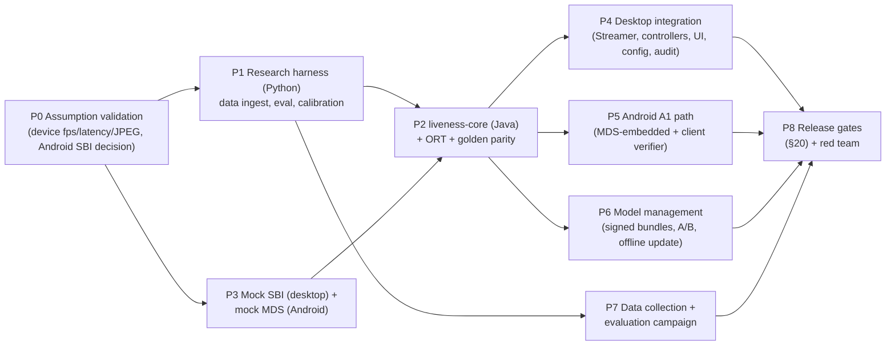

| Phase | Output | Exit criterion |
|---|---|---|
| P0 | Device characterization report; Android path decision record | fps, latency and JPEG quality measured on ≥ 1 real device; A1/A2/A3 decided with MOSIP |
| P1 | Python evaluation harness; baseline model results on public + pilot data | Reproducible per-PAI report |
| P2 | `liveness-core` with Stage 1, quality, tracking, state machine, challenges | Unit + parity + property tests green; latency budget met on the reference CPU (replay) |
| P3 | Mock SBI (HTTP M-JPEG + signed RCAPTURE) and mock Android MDS | Contract tests green |
| P4 | Desktop integration across all three workflows | E2E green with mock and with one real device |
| P5 | Android A1 implementation against mock MDS | E2E green |
| P6 | Bundle signing, verification, A/B, rollback, offline import | Fault-injection suite green |
| P7 | Consented dataset; trained/calibrated models; evaluation report | Report meets §20 gates |
| P8 | Release candidate | All gates signed off |

**Approval checkpoint:** this document should be approved, and P0 completed, before any large-scale change to the Registration Client or addition of substantial dependencies (ORT, models).

---

## 19. Major risks and mitigations

| # | Risk | Likelihood / Impact | Mitigation |
|---|---|---|---|
| K1 | Android client cannot access frames; SBI extension not adopted by vendors | High / High | Pursue A1 with MOSIP; deliver against the mock MDS; document the dependency explicitly |
| K2 | Device stream too slow (≈ 3 fps) or too compressed for PAD cues | Medium / High | P0 measurement; PAD on the signed high-quality RCAPTURE image; capability-gated challenges (no blink below ~10 fps, threshold to be measured) |
| K3 | No licence-clean training data at the required scale | High / High | Early consented collection programme; public sets for research only |
| K4 | Cross-device generalization failure | High / High | Device-profile calibration; unknown device → strictest profile; per-device gates |
| K5 | Interactive-replay / screen-deepfake bypass | Medium / High | Stage-2 screen cues; red-team gating; document as residual; Architecture C for high-assurance sites |
| K6 | Injection on L0 devices | Medium / High | Signed-capture binding; prefer L1 for operator/supervisor; CEN/TS 18099-informed test plan as future work |
| K7 | BPCER too high (operator friction), pressure to lower thresholds | Medium / Medium | Manifest bounds; first-attempt BPCER gate; UX guidance quality |
| K8 | Demographic disparity | Medium / High | Per-group BPCER gates; balanced collection |
| K9 | JNI/native instability | Low / High | Input bounds, fuzzing, soak; sidecar fallback design ready |
| K10 | Concurrency of STREAM + RCAPTURE varies by vendor | Medium / Medium | Contract tests per vendor; fallback: stream → liveness → then RCAPTURE |

---

## 20. Acceptance criteria for production readiness (release gates)

All thresholds below are **proposed** and must be ratified by the MOSIP risk owner for each deployment.

| Gate | Criterion |
|---|---|
| **G-SEC-1** | System-level attack acceptance per PAI species (§14.2 print, screen, replay families) ≤ **5%** within the max-retry budget, upper 95% CI bound, on held-out subjects and ≥ 1 held-out device. No species without measurement |
| **G-SEC-2** | All invariants I1–I11 covered by passing automated tests; no open high-severity findings from red team or code review |
| **G-SEC-3** | Model/config integrity: tampered bundle or out-of-bounds threshold always refused (100% of fault cases) |
| **G-ACC-1** | Bona fide first-attempt rejection ≤ **5%**; within-retries rejection ≤ **1%**, per supported device |
| **G-ACC-2** | Max/min ratio of per-demographic-group BPCER ≤ **1.5**, with sufficient samples per group (CI reported) |
| **G-LAT-1** | `t_passive_frame` p95 ≤ **100 ms** (hard) on the reference CPU with realistic background load; p99 ≤ 150 ms |
| **G-LAT-2** | `t_total` passive path p95 ≤ **3.5 s** at the device's measured fps (≥ 10 fps devices) |
| **G-REL-1** | 8 h soak: zero crashes, RSS slope ≈ 0, no handle/thread leaks; 500 reconnect cycles pass |
| **G-REL-2** | 100% pass of the fault-injection matrix with fail-closed outcomes |
| **G-INT-1** | Resident, operator and supervisor flows pass E2E on desktop with ≥ 1 real certified device + mock; Android with mock MDS (real vendor MDS before Android GA) |
| **G-OFF-1** | Identical decisions (same replay inputs) with network on and off |
| **G-PRIV-1** | No biometric content in logs, audit or metrics (automated scan); diagnostic mode gated and audited |
| **G-DOC-1** | ISO/IEC 30107-3-style evaluation report published internally with PAI definitions, operating points and CIs. Explicitly **not** a certification claim |

---

## 21. Final design review

**1. What architecture do you recommend, and why?**
Architecture B: a multi-stage, risk-adaptive RGB pipeline.
- **Packaging:** an in-process shared Java core on ONNX Runtime.
- **What it adds over A:** a second diverse PAD model with a guaranteed sampling floor, PAD on the *signed* capture, continuous PAD during active challenges, and a deterministic fail-closed state machine.
- **Why:** it scores highest when security and generalization dominate. It removes A's single-model point of failure without depending on hardware (C) that the SBI contract does not expose.

**2. Which parts are based on published evidence?**
- **Integration facts** (SBI spec + code inspection): the stream contract, the trust model, and the Android constraint.
- **Metrics** (ISO/IEC 30107-3) and the per-PAI reporting discipline (30107-3, NIST FATE PAD scope).
- **Research:** texture/frequency CNN PAD effectiveness in-domain; weak cross-domain generalization; benefit of depth/NIR for 3D and partial attacks; landmark-based blink detection.
- **ORT engineering guidance:** threading, quantization caveats, NNAPI deprecation.

**3. Which decisions remain hypotheses?**
- That Stage 2 adds *diverse* errors (measurable value).
- That PAD cues survive the SBI stream's JPEG compression.
- That Java preprocessing fits the budget.
- That quantization helps on target CPUs.
- The specific thresholds, window sizes and challenge counts.
- That onset-gated challenges add security against replay beyond PAD.
- The latency budgets in §7.2.
- That BioSDK MATCH is fast enough for capture binding.

**4. What are the largest remaining security risks?**
- Injection on L0 devices and unsigned streams.
- Real-time screen puppetry/deepfakes and interactive replay.
- Cut-out prints and 3D masks on RGB-only hardware.
- Cross-device generalization failure.
- On Android, the absence of any trustworthy client-side frame path until an SBI extension exists.

**5. What is the expected critical-path latency, and how is it measured?**
- **Per frame:** budget p95 ≈ 45–60 ms, hard target ≤ 100 ms on the reference 4-core AVX2 CPU. Measured with monotonic-clock spans per stage (§7.1) via replay benchmarks, JMH microbenchmarks and live-device runs (§13).
- **Decision time:** passive about 1–2 s at ≥ 10 fps, bounded by the evidence window and fps; challenges add roughly 2.5–5 s each (human-bound). These are budgets, not measurements.

**6. What hardware is required?**
- **Desktop:** an x86-64 4-core AVX2 CPU, 8 GB RAM, Windows 10/11 x64; no GPU; a certified SBI face device with STREAM support (L1 preferred for operator/supervisor).
- **Android:** API 28+ (client minSdk), arm64-v8a, hardware-backed keystore (SBI requirement), and roughly ≥ 3 GB RAM for MDS-embedded inference (to validate).
- **Architecture C:** devices with co-registered depth/NIR *and* an SBI extension; none verified.

**7. What can be shared between Desktop and Android?**
The entire `liveness-core`: quality, detection/tracking, PAD, aggregation, challenges, state machine, policy validation, model manager, telemetry schema, reason/guidance catalogues and test corpora. Frame sources, decoding, UI rendering, packaging and key handling are platform-specific.

**8. What prevents production readiness today?**
- No licence-clean training and evaluation data from target devices.
- No measured device stream characteristics.
- No Android frame path (SBI extension and vendor adoption needed).
- No calibrated thresholds.
- No independent PAD evaluation.
- No product decision on the recovery process.
- No implementation.

**9. What are the minimum acceptance criteria for a credible release?**
The §20 gates, at minimum G-SEC-1/2/3, G-ACC-1/2, G-LAT-1, G-REL-2, G-OFF-1 and G-PRIV-1, measured on held-out subjects and devices with confidence intervals and per-PAI reporting.

**10. Which three experiments would most effectively validate or invalidate this architecture?**
1. **Device stream characterization + compression robustness.** Measure fps, latency and JPEG quality of real SBI streams. Evaluate candidate PAD models on the same attacks captured via STREAM vs. RCAPTURE.
   - *Invalidates* client-side stream PAD if fps < ~5 or compression collapses screen/print separability. That would force PAD primarily onto the signed capture, or into the MDS.
2. **Cross-device / leave-one-PAI-out benchmark with error-diversity analysis.** Evaluate Stage 1 and Stage 2 candidates on consented target-device data at fixed BPCER.
   - *Invalidates* B in favour of A if Stage-2 errors are highly correlated with Stage 1, i.e. no APCER gain at equal BPCER.
3. **Adaptive red-team on the full system.** Test interactive replay with challenge-clip libraries, cut-out prints and high-PPI tablet replay, comparing system-level attack acceptance and time-to-decision with active challenges on vs. off.
   - *Invalidates* the current role of active challenges if they do not reduce attack acceptance beyond PAD alone. That would shift investment to PAD and hardware rather than more challenge types.

---

## 22. References

**Standards and specifications**
- ISO/IEC 30107-1:2023, *Biometric presentation attack detection — Part 1: Framework*.
- ISO/IEC 30107-3:2023, *Part 3: Testing and reporting*.
- ISO/IEC 30107-4, *Part 4: Profile for testing of mobile devices* (edition to be verified).
- ISO/IEC 19794-5:2011, *Biometric data interchange formats — Part 5: Face image data*.
- CEN/TS 18099:2024, *Biometric data injection attack detection*.
- MOSIP SBI (MDS) Specification, MOSIP Docs 1.2.0 — https://docs.mosip.io/1.2.0/id-lifecycle-management/supporting-components/biometrics/mds-specification
- MOSIP Registration Client and Android Registration Client documentation, MOSIP Docs 1.2.0.
- NIST IR 8491, Ngan, Grother, Hom, *Face Analysis Technology Evaluation (FATE) Part 10: Performance of Passive, Software-Based Presentation Attack Detection (PAD) Algorithms*, 2023 — https://nvlpubs.nist.gov/nistpubs/ir/2023/NIST.IR.8491.pdf

**Code**
- `mosip/registration-client` @ `22fe01f` — https://github.com/mosip/registration-client
- `mosip/android-registration-client` @ `8f4643a` — https://github.com/mosip/android-registration-client

**Research**
- Yu Z. et al., *Deep Learning for Face Anti-Spoofing: A Survey*, IEEE TPAMI 2023. arXiv:2106.14948.
- Boulkenafet Z. et al., *OULU-NPU: A Mobile Face Presentation Attack Database with Real-World Variations*, IEEE FG 2017.
- Boulkenafet Z., Komulainen J., Hadid A., *Face Spoofing Detection Using Colour Texture Analysis*, IEEE TIFS 2016.
- Liu Y., Jourabloo A., Liu X., *Learning Deep Models for Face Anti-Spoofing: Binary or Auxiliary Supervision*, CVPR 2018.
- Liu Y. et al., *Deep Tree Learning for Zero-shot Face Anti-Spoofing*, CVPR 2019.
- George A., Marcel S., *Deep Pixel-wise Binary Supervision for Face Presentation Attack Detection*, ICB 2019.
- George A. et al., *Biometric Face Presentation Attack Detection with Multi-Channel Convolutional Neural Network*, IEEE TIFS 2020.
- Zhang S. et al., *A Dataset and Benchmark for Large-scale Multi-modal Face Anti-spoofing* (CASIA-SURF), CVPR 2019.
- Yu Z. et al., *Searching Central Difference Convolutional Networks for Face Anti-Spoofing*, CVPR 2020.
- Jia Y. et al., *Single-Side Domain Generalization for Face Anti-Spoofing*, CVPR 2020.
- Zhang Y. et al., *CelebA-Spoof: Large-Scale Face Anti-Spoofing Dataset with Rich Annotations*, ECCV 2020.
- Sun Y. et al., *Rethinking Domain Generalization for Face Anti-Spoofing: Separability and Alignment*, CVPR 2023.
- Srivatsan K., Naseer M., Nandakumar K., *FLIP: Cross-domain Face Anti-spoofing with Language Guidance*, ICCV 2023.
- Ham, Saptawijaya, Arymurthy, *Domain Generalization and Domain Adaptation Approaches for Face Anti-Spoofing: A Survey*, IEEE Access 13, 2025.
- Soukupová T., Čech J., *Real-Time Eye Blink Detection using Facial Landmarks*, CVWW 2016.
- Wu W., Peng H., Yu S., *YuNet: A Tiny Millisecond-level Face Detector*, Machine Intelligence Research 2023.

**Engineering documentation**
- ONNX Runtime — Thread management: https://onnxruntime.ai/docs/performance/tune-performance/threading.html
- ONNX Runtime — Quantization: https://onnxruntime.ai/docs/performance/model-optimizations/quantization.html
- ONNX Runtime — Execution providers; 1.21.0 release notes (NNAPI deprecation): https://onnxruntime.ai/docs/execution-providers/
- MediaPipe Face Landmarker: https://developers.google.com/edge/mediapipe/solutions/vision/face_landmarker
- MiniVision Silent-Face-Anti-Spoofing (Apache-2.0): https://github.com/minivision-ai/Silent-Face-Anti-Spoofing

**Not verified in this pass (do not rely on these without checking):** the exact 2023 wording of the 30107-3 metrics; the 30107-4 edition; the detailed NIST IR 8491 findings; MOSIP's reference registration-kit hardware minimums; licence terms of individual model weights (MediaPipe bundles, YuNet), to be checked against each model card before use.
